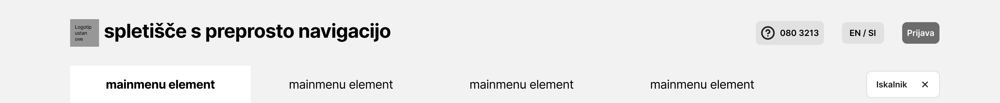
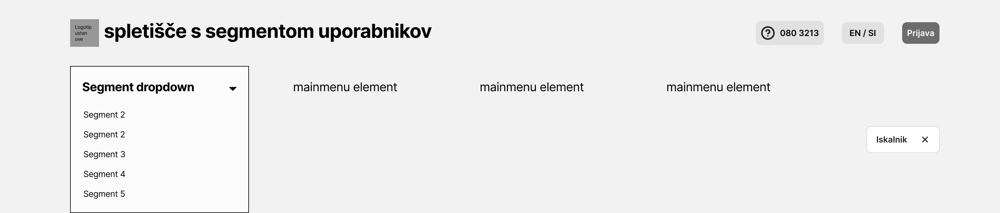
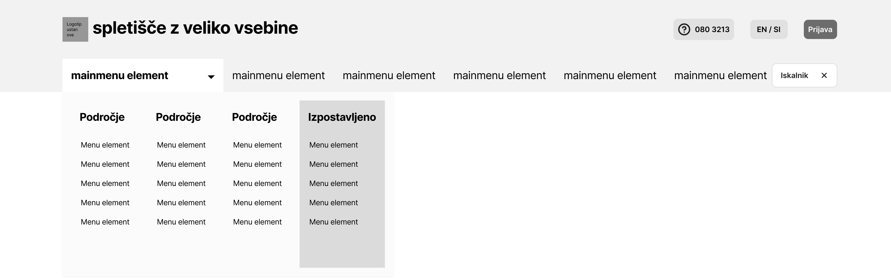
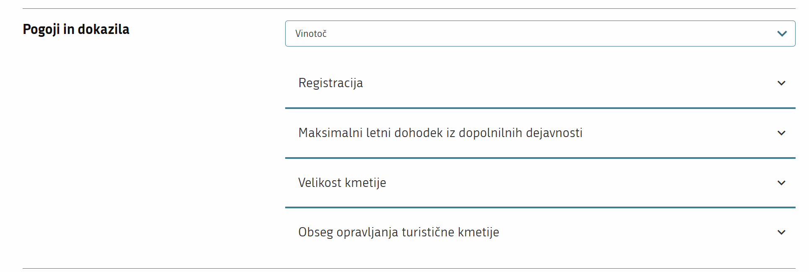
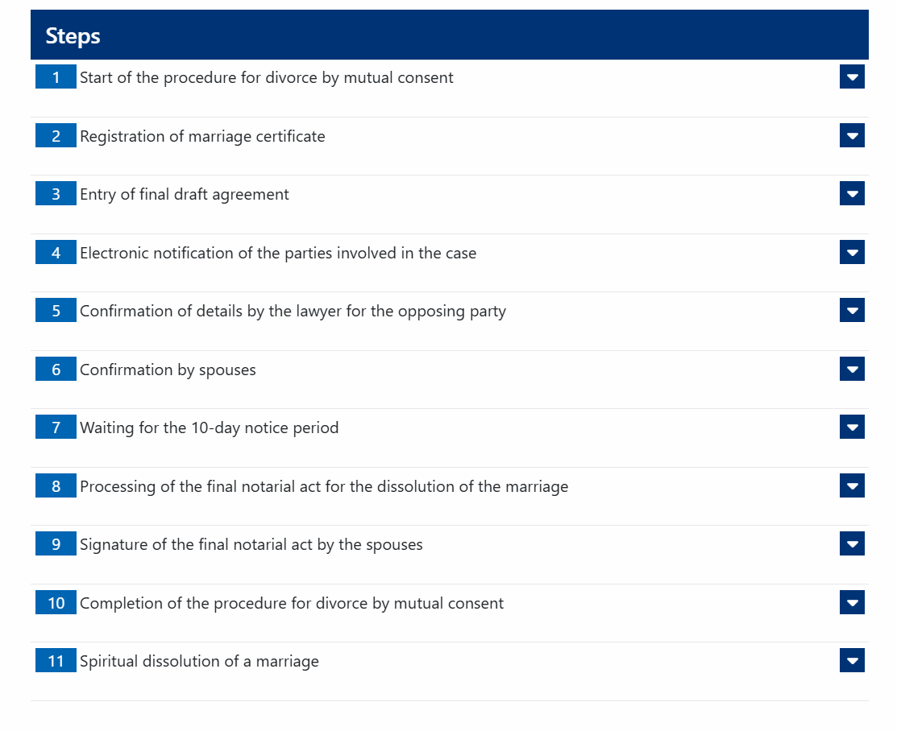
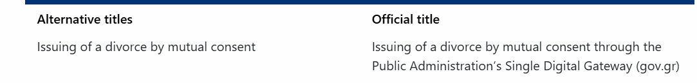
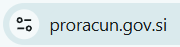
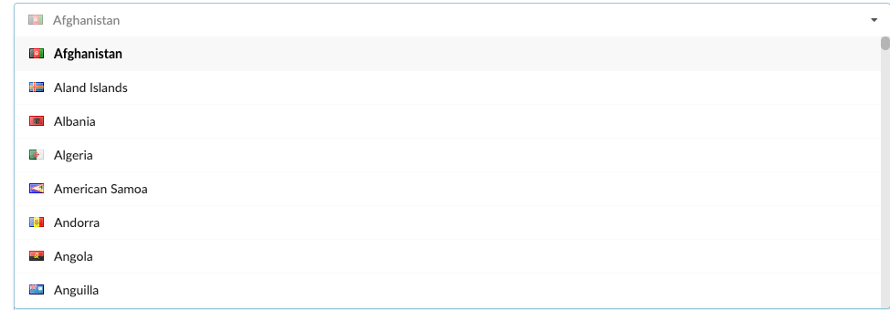
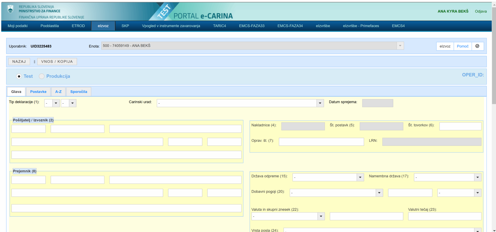

# Standardi — združen izvoz iz Notiona

Vir: `Export Notion.zip`. Dokument združuje vseh 83 zapisov iz izvoza in ohranja njihova izvirna besedila, metapodatke, komentarje ter priloge. Dve vsebinsko enaki CSV tabeli sta upoštevani enkrat. Razvrstitev sledi polju »Področje«, znotraj področij pa številki ID.

Statusi v izvozu: **65 Potrjen MDP**, **18 Odpisan**. Statusi so povzeti iz izvoza; dokument ne predstavlja nove potrditve zahtev ali njihove veljavnosti za projekt MAG-NET. Navodila in zahteve v besedilih so vsebina vira.

Slike so v priloženi mapi `slike/`. Povezave na Notion in zunanje spletne strani so ohranjene; vsebina povezanih strani, ki je izvoz ne vsebuje, ni vključena.

## Kazalo

- [Načrtovanje in upravljanje](#podrocje-1) (10)
- [spletišča](#podrocje-2) (12)
- [vloga](#podrocje-3) (22)
- [pomoč uporabnikom](#podrocje-4) (4)
- [Vsebine in besedila](#podrocje-5) (2)
- [url naslovi](#podrocje-6) (8)
- [UX](#podrocje-7) (8)
- [varnost in zasebnost](#podrocje-8) (6)
- [UI](#podrocje-9) (6)
- [Brez navedenega področja](#podrocje-10) (2)
- [Dostopnost](#podrocje-11) (2)
- [UI, vloga](#podrocje-12) (1)

## Pregled zapisov

| ID | Standard | Status | Področje |
| --- | --- | --- | --- |
| [ST-1](#st-1) | Storitev MORA uporabljati UI elemente iz oblikovalskega sistema. | Potrjen MDP | UI |
| [ST-2](#st-2) | Storitev MORA vizualno izpostaviti primarno akcijo na strani. | Potrjen MDP | UX |
| [ST-3](#st-3) | Storitev NE SME prikazovati pojavnih oken, ki jih uporabnik ni sam sprožil. | Potrjen MDP | UX |
| [ST-5](#st-5) | Storitev MORA imeti izpisane korake postopka pred začetkom postopka. | Potrjen MDP | vloga |
| [ST-6](#st-6) | Storitev MORA biti sestavljena iz najmanj treh delov: predstavitev storitve, izvedba postopka storitve, zaključek storitve. | Potrjen MDP | vloga |
| [ST-7](#st-7) | Storitev MORA v največ 1 sekundi uporabnika obvestiti o stanju sistema. | Potrjen MDP | UX |
| [ST-8](#st-8) | Spletišča MORAJO imeti povezovalni vizualni gradnik. | Potrjen MDP | spletišča |
| [ST-10](#st-10) | Spletišče MORA uporabiti enega izmed konceptov navigacije določenih v oblikovalskem sistemu.  | Potrjen MDP | spletišča |
| [ST-11](#st-11) | Storitev MORA uporabljati standardizirani gradnik za piškotke. | Odpisan | varnost in zasebnost |
| [ST-12](#st-12) | Storitev MORA omogočiti, da uporabnik geslo vidi, ko ga vnaša. | Potrjen MDP | varnost in zasebnost |
| [ST-13](#st-13) | Storitev MORA dovoliti vnos zapomnljivega gesla. | Potrjen MDP | varnost in zasebnost |
| [ST-14](#st-14) | Storitve NE SMEJO onemogočati avtomatskega vnosa uporabniških imen in gesel iz upravljalcev gesel. | Potrjen MDP | varnost in zasebnost |
| [ST-15](#st-15) | PRIPOROČENA JE uporaba preprostih načinov prijav v sisteme z uporabo komercialnih ponudnikov avtentikacije. | Odpisan | varnost in zasebnost |
| [ST-16](#st-16) | Storitve NE SMEJO za svoje normalno delovanje  uporabljati Turingovih testov za prepoznavanje robotov (CAPTCHA). | Potrjen MDP | varnost in zasebnost |
| [ST-17](#st-17) | Spletišče MORA imeti enoten kontakt za vsebinsko in tehnično podporo. | Potrjen MDP | pomoč uporabnikom |
| [ST-18](#st-18) | Spletišča MORAJO uporabiti isto UI komponento s kontakti za pomoč uporabnikom. | Potrjen MDP | pomoč uporabnikom |
| [ST-19](#st-19) | Storitev MORA imeti javno dostopna navodila za izpolnjevanje vloge. | Potrjen MDP | vloga |
| [ST-20](#st-20) | Storitve MORAJO ob navajanju številk za pomoč uporabnikom navesti informacijo o rabi zasebnih podatkov. | Odpisan | pomoč uporabnikom |
| [ST-21](#st-21) | Spletišča in aplikacije MORAJO biti poimenovana s slovenskim imeni, skovankami ali izpeljankami iz slovenskih besed.  | Potrjen MDP | spletišča |
| [ST-23](#st-23) | Spletne strani s samostojno storitvijo NE SMEJO uporabljati lastne domene, ampak morajo biti dostopne kot poddomena domene gov.si.  | Odpisan | — |
| [ST-24](#st-24) | Url spletišča se MORA ujemati z njegovim imenom. | Potrjen MDP | url naslovi |
| [ST-25](#st-25) | Spletišče MORA med dvema besedama v url naslovih uporabiti vezaj. | Potrjen MDP | url naslovi |
| [ST-27](#st-27) | Uporaba predpone “e” v imenih spletišč SE NE PRIPOROČA. | Odpisan | spletišča |
| [ST-28](#st-28) | Spletišče MORA url naslov s predpono “e-” preusmeriti na url brez vezaja. | Potrjen MDP | url naslovi |
| [ST-29](#st-29) | Spletišče MORA uporabiti uporabniku razumljive url naslove. | Potrjen MDP | url naslovi |
| [ST-31](#st-31) | Storitev NE SME uporabljati poddomen brez vsebinske semantike. | Potrjen MDP | url naslovi |
| [ST-32](#st-32) | PRIPOROČA SE uporaba samo ene poddomene. | Odpisan | url naslovi |
| [ST-33](#st-33) | Spletišče NE SME uporabljati strokovnih terminov in kratic. Če se uporabijo strokovni termini in kratice, morajo biti razloženi. | Potrjen MDP | Vsebine in besedila |
| [ST-34](#st-34) | Spletišče MORA na vsebinski strani imeti napisan datum zadnje spremembe oziroma objave besedila. | Potrjen MDP | spletišča |
| [ST-35](#st-35) | Spletišče MORA na vsebinski strani imeti napisano ime odgovorne institucije za vsebino. | Odpisan | spletišča |
| [ST-36](#st-36) | Spletišče MORA omogočiti uporabniku, da sporoči morebitne nepravilnosti glede vsebine. | Potrjen MDP | spletišča |
| [ST-37](#st-37) | Spletišče MORA biti označeno, če ni več v uporabi in ažurno. | Potrjen MDP | spletišča |
| [ST-38](#st-38) | Storitev MORA zagotavljati ključne funkcionalnosti na vseh napravah. | Potrjen MDP | UX |
| [ST-39](#st-39) | Spletišča in storitve MORAJO ustrezati zadnji verziji standardov WCAG  in biti skladna z ZDSMA. | Potrjen MDP | Dostopnost |
| [ST-40](#st-40) | Storitev ali spletišče MORA uporabljati ikonografijo iz centralnega repozitorija. | Potrjen MDP | UI |
| [ST-41](#st-41) | Storitev MORA upoštevati načela dobrega UX in UI oblikovanja. | Odpisan | UX |
| [ST-42](#st-42) | Storitev NE SME od uporabnika storitve zahtevati podatkov, ki jih je mogoče pridobiti iz obstoječih podatkovnih virov. | Potrjen MDP | UX |
| [ST-45](#st-45) | Kompleksnejše storitve so lahko v polnem obsegu na voljo na večjih zaslonih, pri čemer se funkcionalnost na manjših napravah postopoma prilagaja ali zmanjšuje. | Odpisan | — |
| [ST-51](#st-51) | Vloga MORA vsebovati vse osnovne sestavne UI elemente. | Potrjen MDP | UI, vloga |
| [ST-52](#st-52) | Storitev MORA uporabniku omogočati premikanje nazaj na poljubni predhodni korak vloge. | Potrjen MDP | vloga |
| [ST-53](#st-53) | Storitev MORA med izpolnjevanjem vloge ponujati napotke za izpolnjevanje. | Potrjen MDP | vloga |
| [ST-54](#st-54) | Storitev MORA omogočiti prenos izpolnjene vloge ali obrazca.  | Potrjen MDP | vloga |
| [ST-55](#st-55) | Storitev MORA omogočiti predogled izpolnjene vloge ali obrazca, preden ga uporabnik odda. | Potrjen MDP | vloga |
| [ST-56](#st-56) | Gumb za začetek postopka MORA biti jasno izpostavljen. | Potrjen MDP | vloga |
| [ST-57](#st-57) | Storitev MORA povratne informacije kazati dokler jih uporabnik ne zapre. | Potrjen MDP | pomoč uporabnikom |
| [ST-58](#st-58) | Storitev MORA zagotoviti povratno informacijo o (ne)uspešnosti oddane vloge, neposredno po oddaji vloge. | Potrjen MDP | vloga |
| [ST-59](#st-59) | Storitev MORA uporabniku po oddani vlogi na e-naslov poslati obvestilo o oddani vlogi in korakih, ki sledijo. | Potrjen MDP | vloga |
| [ST-60](#st-60) | Storitev MORA uporabnika obveščati o spremembi statusa vloge. | Potrjen MDP | vloga |
| [ST-61](#st-61) | Storitev MORA samodejno shranjevati podatke, ki jih uporabnik vnaša pri izpolnjevanju obrazca. | Potrjen MDP | vloga |
| [ST-63](#st-63) | Storitev MORA uporabnika skozi celoten postopek informirati na katerem portalu je | Odpisan | vloga |
| [ST-64](#st-64) | Spustni seznam MORA uporabniku izbor olajšati s predlaganimi izbirami na podlagi delnega vnosa. | Potrjen MDP | UI |
| [ST-65](#st-65) | Sistem MORA sproti preverjati pravilnost vnosov in uporabniku takoj sporočati napake pri vnosu podatkov. | Potrjen MDP | vloga |
| [ST-66](#st-66) | Storitev MORA omogočiti dvostopenjsko potrjevanje korakov pri dejanjih, ki jih ni mogoče razveljaviti in uporabnika informirati o posledicah odločitve. | Potrjen MDP | vloga |
| [ST-67](#st-67) | Storitev MORA imeti poleg uradnega naziva tudi preprost, kratek in pomenljiv naziv. | Potrjen MDP | vloga |
| [ST-68](#st-68) | Storitev MORA uporabljati skupna poimenovanja gumbov za tipične akcije ali dejanja uporabnika. | Potrjen MDP | vloga |
| [ST-69](#st-69) | Če uporabnik izbere drug jezik, potem spletišče MORA prikazati vse elemente in vsebino izključno v jeziku, ki ga je izbral.  | Potrjen MDP | spletišča |
| [ST-72](#st-72) | Storitev MORA imeti jasna poimenovanja za vnosna polja ali polja izbire. | Potrjen MDP | UI |
| [ST-74](#st-74) | Storitev MORA biti vpisana v register storitev. | Potrjen MDP | Načrtovanje in upravljanje |
| [ST-75](#st-75) | Storitev MORA biti podrobneje opisana z meta podatki. | Odpisan | Načrtovanje in upravljanje |
| [ST-76](#st-76) | Skrbniki storitev MORAJO vsaj 1x na tri leta izvesti uporabniško raziskavo. | Potrjen MDP | Načrtovanje in upravljanje |
| [ST-77](#st-77) | Ob načrtovanju nove storitve se MORA izvesti uporabniško testiranje. | Potrjen MDP | Načrtovanje in upravljanje |
| [ST-79](#st-79) | Storitev MORA imeti gumb za naprej umeščen desno od gumba za nazaj. | Potrjen MDP | vloga |
| [ST-80](#st-80) | PRIPOROČENO JE, da storitev uporablja skupne gradnike. | Potrjen MDP | Načrtovanje in upravljanje |
| [ST-92](#st-92) | PRIPOROČENO JE, da spletišče storitve nudi seznam in obrazložitev najpogosteje uporabljenih strokovnih izrazov. | Potrjen MDP | Vsebine in besedila |
| [ST-93](#st-93) | Storitev MORA uporabniku posredovati vse osnovne informacije o storitvi. | Potrjen MDP | vloga |
| [ST-100](#st-100) | Storitev NE SME izvajati akcij namesto uporabnika, če je sam ni sprožil. | Odpisan | UX |
| [ST-101](#st-101) | Spletišča MORAJO v url naslovih uporabljati slovenske besede | Odpisan | url naslovi |
| [ST-102](#st-102) | PRIPOROČA SE, da so IT sistemi poimenovani s slovenskimi imeni, skovankami ali izpeljankami iz slovenskih besed.  | Potrjen MDP | spletišča |
| [ST-120](#st-120) | Storitev MORA med izpolnjevanjem vlog predizpolniti polja, če je to mogoče. | Odpisan | UX |
| [ST-121](#st-121) | Spletišče MORA imet javno dostopen seznam vseh (digitalnih) javnih storitev, ki jih spletišče ponuja. | Odpisan | spletišča |
| [ST-122](#st-122) | Spletišče MORA zagotavljati iskalnik ali filtriranje po storitvah, ki so na voljo uporabnikom. | Odpisan | spletišča |
| [ST-123](#st-123) | Storitev MORA uporabljati predpisane barve. | Potrjen MDP | UI |
| [ST-124](#st-124) | Storitev MORA uporabljati predpisano tipografijo. | Potrjen MDP | UI |
| [ST-125](#st-125) | Storitve MORAJO biti razvite po principu “najprej za mobilne naprave” | Potrjen MDP | Načrtovanje in upravljanje |
| [ST-126](#st-126) | Uporabniku MORA biti na enem mestu omogočen enostaven pregled nad vsemi storitvami, ki jih institucija ali organ ponuja. | Potrjen MDP | Načrtovanje in upravljanje |
| [ST-127](#st-127) | Spletišče MORA prijavljenemu uporabniku omogočati pregled nad shranjenimi in oddanimi vlogami. | Potrjen MDP | vloga |
| [ST-128](#st-128) | PRIPOROČA se pripravo vodičev, ki uporabnika usmerjajo do pravih storitev, postopkov ali vlog. | Potrjen MDP | vloga |
| [ST-130](#st-130) | Spletišče MORA uporabljati sistem za zbiranje podatkov o uporabi spletišča in storitev (podatkovna analitika). | Potrjen MDP | Načrtovanje in upravljanje |
| [ST-131](#st-131) | PRIPOROČA se preverjanje ustreznost dostopnosti, ob vsaki večji spremembi WCAG standardov oziroma ob nadgradnji storitev ali spletišč. | Potrjen MDP | Dostopnost |
| [ST-135](#st-135) | Vsaka nova javna storitev MORA biti najprej zasnovana digitalno. | Odpisan | Načrtovanje in upravljanje |
| [ST-136](#st-136) | Skrbnik storitve SE MORA udeležiti vsaj 1 usposabljanja na temo uporabniške izkušnje. | Potrjen MDP | Načrtovanje in upravljanje |
| [ST-139](#st-139) | Storitev MORA omogočiti uporabniku možnost oddaje povratne informacije o storitvi, prijavo napak in predlogov za izboljšanje storitve. | Potrjen MDP | vloga |
| [ST-140](#st-140) | Url spletišča MORA vsebovati naziv spletišča | Odpisan | url naslovi |

## Načrtovanje in upravljanje

### ST-74 — Storitev MORA biti vpisana v register storitev.

**Status:** Potrjen MDP

**Tip standarda:** Zahteva

**Smernice:** Informacije naj bodo popolne, pravilne in ažurne. Če niso, je to označeno.  (https://www.notion.so/Informacije-naj-bodo-popolne-pravilne-in-a-urne-e-niso-je-to-ozna-eno-1fca009db8e48018a506d5d65655bd71?pvs=21), Uporabi se enako poimenovanje in razporeditev vsebin po vseh portalih (https://www.notion.so/Uporabi-se-enako-poimenovanje-in-razporeditev-vsebin-po-vseh-portalih-1f2a009db8e480caa21be4c766ef4081?pvs=21)

**Področje:** Načrtovanje in upravljanje

**Dodatna obrazložitev:** V registru storitev je vsaka storitev opisana z minimalnim naborom meta podatkov. Predlog metapodatkov je opisan v podrobnostih standardi.

**To do / komentar:** Potrebno je določiti seznam meta podatkov. 

**ID:** ST-74

Primeri metapodatkov:

##### **Osnovna identifikacija in opis storitve**

| Ime podatka | Opis podatka | Primer |
| --- | --- | --- |
| **Uradni naziv**  | Uradni naziv storitve, kot ga opredeljuje zakon. | Obračun davčnih odtegljajev po 374. členu ZDavP-2 od plačil dohodkov rezidentov in nerezidentov po 70. členu ZDDPO-2 v povezavi z 260. členom ZDavP-2  |
| **Krajši naziv**  | Skrajšan, jasen in razumljiv opis storitve. | Poročilo o plačilu davka za določene dohodke (npr. storitve, licence, dividende) ali Obrazec za prijavo posebnih vrst dohodkov in plačanega davka. |
| **Kratek opis** | Kratek opis storitve, ki povzema ključne lastnosti in namen storitve. | Centralizirano poročanje o izplačanih dohodkih, ki so predmet davčnega odtegljaja, pri čemer se upoštevajo specifične vrste dohodkov in morebitne ugodnosti iz mednarodnih pogodb , vse pa se evidentira in sporoča davčnemu organu. |
| **Celoten opis** | Podrobnejši opis storitve, ki dodaja in navaja zakonske podlage in druge podrobnosti storitve. | Izplačevalec dohodka (npr. slovensko podjetje) mora, ko izplača določene dohodke (naštete v 70. členu ZDDPO-2) rezidentom ali nerezidentom, od tega dohodka odtegniti in plačati davek v imenu prejemnika. Te podatke mora nato poročati Finančni upravi RS (FURS) preko obrazca, ki se ga nanaša 374. člen ZDavP-2. Če je prejemnik dohodka nerezident, ima morda pravico do znižanja ali oprostitve davka na podlagi mednarodne pogodbe, kar uveljavlja po postopku iz 260. člena ZDavP-2. |
| **Skrbnik storitve**  | Polni naziv institucije, organa ali agencije ter odgovornega direktorata oziroma sektorja (če gre za ministrstvo). | Ministrsvo za finance
Finančna uprava Republike Slovenije |
| **Ciljne skupine** | Seznam uporabniških skupin, katerim je storitev namenjena (iz seznama) | Pravne osebe, Samostoji podjetniki, Fizične osebe |
| **Edinstveni identifikator (ID storitve)** | Sistemsko generiran edinstveni ID za notranje upravljanje baze podatkov. | Primer: DPS-000123 |
| **URL storitve/Neposredna povezava** | Neposredna povezava do same digitalne storitve. | [https://edavki.durs.si/edavkiportal/openportal/CommonPages/Opdynp/PageD.aspx?category=davcni_odtegljaj_od_placil_rezidentov_in_nerezidentov_fod](https://edavki.durs.si/edavkiportal/openportal/CommonPages/Opdynp/PageD.aspx?category=davcni_odtegljaj_od_placil_rezidentov_in_nerezidentov_fod) |
| **Kontaktni podatki** | E-naslov ali telefonska številka za podporo uporabnikom. | furs@gov.si |
| **Pravna podlaga** | Seznam pravnih dokumentov, ki storitev predpisujejo ali urejajo. | Zakon o davku od dohodkov pravnih oseb (ZDDPO-2)
Zakon o davčnem postopku (ZDavP-2) |

##### Klasifikacija in kategorizacija

| Ime podatka | Opis podatka | Primer(i) |
| --- | --- | --- |
| Vrsta storitve | Katero področje pokriva storitev? | Finančna storitev |
| Tip storitve | Tip storitve opisuje lastnosti storitve. | Obračun |
| Življenjski dogodek | Izbor primernega življenjskega dogodka, kamor spada storitev. | Poslovanje (delo) |
| Način izvajanja | Opis možnih načinov izvajanja storitve. | Digitalno, osebno |
| Razpoložljivi jeziki | Seznam jezikov v katerih je mogoče vlogo izpolniti. | Slovenščina |
| Status | Kakšen je razvojni status storitve?
- v razvoju
- načrtovana
- aktivna
- umaknjena | Aktivna |
| Postopki | Predpisan seznam postopkov, ki jih storitev zajema. |  |
| Vloge | Seznam vlog, ki jih postopki zahtevajo. |  |

[Na kazalo](#kazalo)

---

### ST-75 — Storitev MORA biti podrobneje opisana z meta podatki.

**Status:** Odpisan

**Tip standarda:** Priporočilo

**Smernice:** Uporabi se enako poimenovanje in razporeditev vsebin po vseh portalih (https://www.notion.so/Uporabi-se-enako-poimenovanje-in-razporeditev-vsebin-po-vseh-portalih-1f2a009db8e480caa21be4c766ef4081?pvs=21)

**Področje:** Načrtovanje in upravljanje

**Dodatna obrazložitev:** Seznam meta podatkov je na voljo v prilogi. 

**ID:** ST-75

##### **Osnovna identifikacija in opis storitve**

| Ime podatka | Opis podatka | Primer |
| --- | --- | --- |
| **Uradni naziv**  | Uradni naziv storitve, kot ga opredeljuje zakon. | Obračun davčnih odtegljajev po 374. členu ZDavP-2 od plačil dohodkov rezidentov in nerezidentov po 70. členu ZDDPO-2 v povezavi z 260. členom ZDavP-2  |
| **Krajši naziv**  | Skrajšan, jasen in razumljiv opis storitve. | Poročilo o plačilu davka za določene dohodke (npr. storitve, licence, dividende) ali Obrazec za prijavo posebnih vrst dohodkov in plačanega davka. |
| **Kratek opis** | Kratek opis storitve, ki povzema ključne lastnosti in namen storitve. | Centralizirano poročanje o izplačanih dohodkih, ki so predmet davčnega odtegljaja, pri čemer se upoštevajo specifične vrste dohodkov in morebitne ugodnosti iz mednarodnih pogodb , vse pa se evidentira in sporoča davčnemu organu. |
| **Celoten opis** | Podrobnejši opis storitve, ki dodaja in navaja zakonske podlage in druge podrobnosti storitve. | Izplačevalec dohodka (npr. slovensko podjetje) mora, ko izplača določene dohodke (naštete v 70. členu ZDDPO-2) rezidentom ali nerezidentom, od tega dohodka odtegniti in plačati davek v imenu prejemnika. Te podatke mora nato poročati Finančni upravi RS (FURS) preko obrazca, ki se ga nanaša 374. člen ZDavP-2. Če je prejemnik dohodka nerezident, ima morda pravico do znižanja ali oprostitve davka na podlagi mednarodne pogodbe, kar uveljavlja po postopku iz 260. člena ZDavP-2. |
| **Skrbnik storitve**  | Polni naziv institucije, organa ali agencije ter odgovornega direktorata oziroma sektorja (če gre za ministrstvo). | Ministrsvo za finance
Finančna uprava Republike Slovenije |
| **Ciljne skupine** | Seznam uporabniških skupin, katerim je storitev namenjena (iz seznama) | Pravne osebe, Samostoji podjetniki, Fizične osebe |
| **Edinstveni identifikator (ID storitve)** | Sistemsko generiran edinstveni ID za notranje upravljanje baze podatkov. | Primer: DPS-000123 |
| **URL storitve/Neposredna povezava** | Neposredna povezava do same digitalne storitve. | [https://edavki.durs.si/edavkiportal/openportal/CommonPages/Opdynp/PageD.aspx?category=davcni_odtegljaj_od_placil_rezidentov_in_nerezidentov_fod](https://edavki.durs.si/edavkiportal/openportal/CommonPages/Opdynp/PageD.aspx?category=davcni_odtegljaj_od_placil_rezidentov_in_nerezidentov_fod) |
| **Kontaktni podatki** | E-naslov ali telefonska številka za podporo uporabnikom. | furs@gov.si |
| **Pravna podlaga** | Seznam pravnih dokumentov, ki storitev predpisujejo ali urejajo. | Zakon o davku od dohodkov pravnih oseb (ZDDPO-2)
Zakon o davčnem postopku (ZDavP-2) |

##### Klasifikacija in kategorizacija

| Ime podatka | Opis podatka | Primer(i) |
| --- | --- | --- |
| Vrsta storitve | Katero področje pokriva storitev? | Finančna storitev |
| Tip storitve | Tip storitve opisuje lastnosti storitve. | Obračun |
| Življenjski dogodek | Izbor primernega življenjskega dogodka, kamor spada storitev. | Poslovanje (delo) |
| Način izvajanja | Opis možnih načinov izvajanja storitve. | Digitalno, osebno |
| Razpoložljivi jeziki | Seznam jezikov v katerih je mogoče vlogo izpolniti. | Slovenščina |
| Status | Kakšen je razvojni status storitve?
- v razvoju
- načrtovana
- aktivna
- umaknjena | Aktivna |

[Na kazalo](#kazalo)

---

### ST-76 — Skrbniki storitev MORAJO vsaj 1x na tri leta izvesti uporabniško raziskavo.

**Status:** Potrjen MDP

**Tip standarda:** Zahteva

**Smernice:** Ko se načrtuje storitve naj se upošteva in spremlja obnašanje uporabnikov.  (https://www.notion.so/Ko-se-na-rtuje-storitve-naj-se-upo-teva-in-spremlja-obna-anje-uporabnikov-1fca009db8e4807ba41bef3219babfa0?pvs=21)

**Področje:** Načrtovanje in upravljanje

**Dodatna obrazložitev:** Skrbniki storitev vsaj 1x na tri leta izvedejo uporabniško raziskavo z namenom pridobivanja povratne informacije o uporabniški izkušnji njihovih digitalnih javnih storitev.

**ID:** ST-76

**Enotni standardi:** 8.6 Vsaj enkrat na dve leti skrbniki spletnih mest izvedejo testiranje uporabniške izkušnje in na podlagi rezultatov testiranja pripravijo načrt optimizacije spletnega mesta.

[Na kazalo](#kazalo)

---

### ST-77 — Ob načrtovanju nove storitve se MORA izvesti uporabniško testiranje.

**Status:** Potrjen MDP

**Tip standarda:** Priporočilo

**Smernice:** Ko se načrtuje storitve naj se upošteva in spremlja obnašanje uporabnikov.  (https://www.notion.so/Ko-se-na-rtuje-storitve-naj-se-upo-teva-in-spremlja-obna-anje-uporabnikov-1fca009db8e4807ba41bef3219babfa0?pvs=21), Razvoj novih digitalnih storitev naj vključuje uporabniška testiranja. (https://www.notion.so/Razvoj-novih-digitalnih-storitev-naj-vklju-uje-uporabni-ka-testiranja-1f2a009db8e480b6836bd71d42728045?pvs=21)

**Področje:** Načrtovanje in upravljanje

**Dodatna obrazložitev:** Uporabniško testiranje naj se izvede vsaj enkrat in naj vključuje vsaj 10 različnih (končnih) uporabnikov storitve. Testiranje mora vključevati testiranje uporabnosti.

**ID:** ST-77

**Enotni standardi:** 8.6 Vsaj enkrat na dve leti skrbniki spletnih mest izvedejo testiranje uporabniške izkušnje in na podlagi rezultatov testiranja pripravijo načrt optimizacije spletnega mesta.

[Na kazalo](#kazalo)

---

### ST-80 — PRIPOROČENO JE, da storitev uporablja skupne gradnike.

**Status:** Potrjen MDP

**Tip standarda:** Zahteva

**Smernice:** Skupne gradnike naj se uporablja za čim več funkcionalnosti (https://www.notion.so/Skupne-gradnike-naj-se-uporablja-za-im-ve-funkcionalnosti-1fca009db8e480729d22eb447d1718e8?pvs=21), Uporabi se enako poimenovanje in razporeditev vsebin po vseh portalih (https://www.notion.so/Uporabi-se-enako-poimenovanje-in-razporeditev-vsebin-po-vseh-portalih-1faa009db8e4801096e6c8f032f85054?pvs=21)

**Področje:** Načrtovanje in upravljanje

**To do / komentar:** Seznam trenutno dostopnih gradnikov  je na voljo kot dokument na NIO.

**ID:** ST-80

[Na kazalo](#kazalo)

---

### ST-125 — Storitve MORAJO biti razvite po principu “najprej za mobilne naprave”

**Status:** Potrjen MDP

**Tip standarda:** Zahteva

**Smernice:** Vsa vsebina naj bo dostopna vsem uporabnikom in vse ključne funkcionalnosti naj bodo uporabne za vse uporabnike. (https://www.notion.so/Vsa-vsebina-naj-bo-dostopna-vsem-uporabnikom-in-vse-klju-ne-funkcionalnosti-naj-bodo-uporabne-za-vse-1f2a009db8e48005b255d4121c83606f?pvs=21)

**Področje:** Načrtovanje in upravljanje

**ID:** ST-125

[Na kazalo](#kazalo)

---

### ST-126 — Uporabniku MORA biti na enem mestu omogočen enostaven pregled nad vsemi storitvami, ki jih institucija ali organ ponuja.

**Status:** Potrjen MDP

**Tip standarda:** Zahteva

**Smernice:** Uporabi se enako poimenovanje in razporeditev vsebin po vseh portalih (https://www.notion.so/Uporabi-se-enako-poimenovanje-in-razporeditev-vsebin-po-vseh-portalih-1f2a009db8e480caa21be4c766ef4081?pvs=21), Uporabi se enako poimenovanje in razporeditev vsebin po vseh portalih (https://www.notion.so/Uporabi-se-enako-poimenovanje-in-razporeditev-vsebin-po-vseh-portalih-21ba009db8e480aea8dddb138f8d258b?pvs=21)

**Področje:** Načrtovanje in upravljanje

**Dodatna obrazložitev:** Enostaven pregled oziroma dostop do storitev spletišče doseže na primer z iskalnikom ali filtri.

**ID:** ST-126

[Na kazalo](#kazalo)

---

### ST-130 — Spletišče MORA uporabljati sistem za zbiranje podatkov o uporabi spletišča in storitev (podatkovna analitika).

**Status:** Potrjen MDP

**Tip standarda:** Zahteva

**Smernice:** Ko se načrtuje storitve naj se upošteva in spremlja obnašanje uporabnikov.  (https://www.notion.so/Ko-se-na-rtuje-storitve-naj-se-upo-teva-in-spremlja-obna-anje-uporabnikov-1fca009db8e4807ba41bef3219babfa0?pvs=21)

**Področje:** Načrtovanje in upravljanje

**ID:** ST-130

[Na kazalo](#kazalo)

---

### ST-135 — Vsaka nova javna storitev MORA biti najprej zasnovana digitalno.

**Status:** Odpisan

**Tip standarda:** Zahteva

**Smernice:** Storitev naj bo zasnovana najprej kot digitalna (https://www.notion.so/Storitev-naj-bo-zasnovana-najprej-kot-digitalna-218a009db8e480eabaa8f21889691424?pvs=21)

**Področje:** Načrtovanje in upravljanje

**ID:** ST-135

[Na kazalo](#kazalo)

---

### ST-136 — Skrbnik storitve SE MORA udeležiti vsaj 1 usposabljanja na temo uporabniške izkušnje.

**Status:** Potrjen MDP

**Tip standarda:** Zahteva

**Smernice:** Razvojna ekipa naj bo interdisciplinarna, sestavljena iz specialistov z raznolikimi znanji in izkušnjami.  (https://www.notion.so/Razvojna-ekipa-naj-bo-interdisciplinarna-sestavljena-iz-specialistov-z-raznolikimi-znanji-in-izku-n-1fca009db8e4807f9cbbc5bbde3fe812?pvs=21)

**Področje:** Načrtovanje in upravljanje

**ID:** ST-136

[Na kazalo](#kazalo)

---

## spletišča

### ST-8 — Spletišča MORAJO imeti povezovalni vizualni gradnik.

**Status:** Potrjen MDP

**Tip standarda:** Zahteva

**Smernice:** Storitev naj deluje kot usklajen in poenoten del sistema digitalnih javnih storitev. (https://www.notion.so/Storitev-naj-deluje-kot-usklajen-in-poenoten-del-sistema-digitalnih-javnih-storitev-1fca009db8e4803c98ffcdb9f3a647f1?pvs=21)

**Področje:** spletišča

**Dodatna obrazložitev:** Povezovalni element je enoten gradnik, ki povezuje spletišča v enotno mrežo spletišč državne uprave. Izgled UI še ni definiran, možne so različne implementacije, npr. v glavi ali v nogi. Gradnik je grafično enoten in vsebuje nekatere skupne funkcionalnosti (kot npr.: iskalnik, meni). 

**To do / komentar:** Potrebno je razviti povezovalni gradnik. 
Potrebno je bolj natančno definirati za katera spletišča ta standard velja in kakšne so lahko izjeme, ter če gre za povezavo z domeno gov.si.

**ID:** ST-8

Povezovalni gradnik je bolj natačno opredeljen v dokumentu “Načrt poenotenega dostopa”, kjer so opredeljeni razlogi in nekaj ilustrativnih možnosti implementacije.

[Na kazalo](#kazalo)

---

### ST-10 — Spletišče MORA uporabiti enega izmed konceptov navigacije določenih v oblikovalskem sistemu.

**Status:** Potrjen MDP

**Tip standarda:** Zahteva

**Smernice:** Uporabi se enako poimenovanje in razporeditev vsebin po vseh portalih (https://www.notion.so/Uporabi-se-enako-poimenovanje-in-razporeditev-vsebin-po-vseh-portalih-1faa009db8e48023a11ad0af52a324df?pvs=21), Uporabi se enako poimenovanje in razporeditev vsebin po vseh portalih (https://www.notion.so/Uporabi-se-enako-poimenovanje-in-razporeditev-vsebin-po-vseh-portalih-1faa009db8e480a5aad6c970eacb7231?pvs=21), Storitev naj deluje kot usklajen in poenoten del sistema digitalnih javnih storitev. (https://www.notion.so/Storitev-naj-deluje-kot-usklajen-in-poenoten-del-sistema-digitalnih-javnih-storitev-1fca009db8e4803c98ffcdb9f3a647f1?pvs=21)

**Področje:** spletišča

**Dodatna obrazložitev:** Konceptov navigacije je več in so določeni v oblikovalskem sistemu, kjer so na voljo tudi UI komponente navigacije. Uporaba različnih standardiziranih UI komponent omogoča lastnikom spletičč, da navigacijo prilagodijo potrebam portala, hkrati pa jih zavezuje k rabi centralno določenih UI elementov in komponent. 
Koncepti vsebujejo vse ravni navigacije: glavno, sekundarno, terciarno, pomožno, navigacijo po vsebini strani, drobtinice. Več o tem je na voljo v podrobnostih standarda.

**To do / komentar:** Potrebno je razviti seznam UI elementov in komponent — kot del oblikovalskega sistema — ki bo omogočal, da vsako spletišče zadosti svojim potrebam. 

**ID:** ST-10

Koncepti navigacije vsebujejo vse ravni navigacije: glavno, sekundarno, terciarno, pomožno, navigacijo po vsebini strani, drobtinice. 
Obstaja več opcij glavne navigacije, primeri: 

[Na kazalo](#kazalo)

---

### ST-21 — Spletišča in aplikacije MORAJO biti poimenovana s slovenskim imeni, skovankami ali izpeljankami iz slovenskih besed.

**Status:** Potrjen MDP

**Tip standarda:** Zahteva

**Smernice:** Uporablja se slovenski jezik (https://www.notion.so/Uporablja-se-slovenski-jezik-1fca009db8e4801982a7d92fd4dd199c?pvs=21), Uporabi se enako poimenovanje in razporeditev vsebin po vseh portalih (https://www.notion.so/Uporabi-se-enako-poimenovanje-in-razporeditev-vsebin-po-vseh-portalih-1fca009db8e48008a73dd63e4d6c52fe?pvs=21)

**Področje:** spletišča

**To do / komentar:** Potrebno uskladiti s pristojnimi organi glede priporočene rabe Slovenščine in zakonodaje na tem področju. 

**ID:** ST-21

Obstoječih imen se ne spreminja, standard velja za nove spletišča in aplikacije.

**PRIPOROČA se rabo kratkih besed, ki so pomensko bogata, izogiba se rabi strokovnih imen, dvoumnih in težko izgovorljivih besed.** 

**PRIPOROČA se uporaba besed in polnih imen namesto kratic**

[Na kazalo](#kazalo)

---

### ST-27 — Uporaba predpone “e” v imenih spletišč SE NE PRIPOROČA.

**Status:** Odpisan

**Tip standarda:** Priporočilo

**Smernice:** Uporabnik naj prepozna, da uporablja uradno in zaupanja vredno storitev države, tako vizualno kot po načinu delovanja. (https://www.notion.so/Uporabnik-naj-prepozna-da-uporablja-uradno-in-zaupanja-vredno-storitev-dr-ave-tako-vizualno-kot-po-1fca009db8e4802192f2f4dfe5f80b1c?pvs=21)

**Področje:** spletišča

**Dodatna obrazložitev:** Predpona e- se je uporabljala kot designacija elektronskih storitev. Ker bodo vse storitve slej ali prej (tudi) elektronske, se rabe predpone e- za nove storitve ne priporoča. 

**ID:** ST-27

Starih se ne preoblikuje, velja samo za nove.

[Na kazalo](#kazalo)

---

### ST-34 — Spletišče MORA na vsebinski strani imeti napisan datum zadnje spremembe oziroma objave besedila.

**Status:** Potrjen MDP

**Tip standarda:** Zahteva

**Smernice:** Informacije naj bodo popolne, pravilne in ažurne. Če niso, je to označeno.  (https://www.notion.so/Informacije-naj-bodo-popolne-pravilne-in-a-urne-e-niso-je-to-ozna-eno-1fca009db8e48018a506d5d65655bd71?pvs=21)

**Področje:** spletišča

**Dodatna obrazložitev:** Standard se navezuje na vsebinske strani storitev (opis storitev, postopkov, vlog).

**ID:** ST-34

[Na kazalo](#kazalo)

---

### ST-35 — Spletišče MORA na vsebinski strani imeti napisano ime odgovorne institucije za vsebino.

**Status:** Odpisan

**Tip standarda:** Zahteva

**Smernice:** Uporabnik naj iz naslova spletne strani prepozna, komu pripada. (https://www.notion.so/Uporabnik-naj-iz-naslova-spletne-strani-prepozna-komu-pripada-1fca009db8e4809fa1d3d5ed168ef029?pvs=21), Uporabnik naj iz naslova spletne strani prepozna, komu pripada. (https://www.notion.so/Uporabnik-naj-iz-naslova-spletne-strani-prepozna-komu-pripada-1fca009db8e480f79e94d4152b21fbf2?pvs=21)

**Področje:** spletišča

**Dodatna obrazložitev:** Avtor je lahko oseba ali Inštitucija. Zaželjeno je, da je ime avtorja povezava na stran predstavitve, kjer uporabnik lahko najde kontakt.

**ID:** ST-35

Če je vsebina na spletišču od druge institucije (in ne institucije, ki je skrbnih spletišča) naj se to navede.

[Na kazalo](#kazalo)

---

### ST-36 — Spletišče MORA omogočiti uporabniku, da sporoči morebitne nepravilnosti glede vsebine.

**Status:** Potrjen MDP

**Tip standarda:** Zahteva

**Smernice:** Uporabi se enako poimenovanje in razporeditev vsebin po vseh portalih (https://www.notion.so/Uporabi-se-enako-poimenovanje-in-razporeditev-vsebin-po-vseh-portalih-1faa009db8e4800ebe4df38b3ab334a4?pvs=21)

**Področje:** spletišča

**To do / komentar:** Potrebno definirati ali ta standard drži tudi za storitve. 
Potrebno je razviti skupen gradnik za povratno informacijo. 
Potrebno je standard združiti z obstoječim standardom. 

**ID:** ST-36

**Enotni standardi:** 8.6 Vsaka stran spletnega mesta ponuja možnost za povratno informacijo – v obliki obrazca.

[Na kazalo](#kazalo)

---

### ST-37 — Spletišče MORA biti označeno, če ni več v uporabi in ažurno.

**Status:** Potrjen MDP

**Tip standarda:** Zahteva

**Smernice:** Informacije naj bodo popolne, pravilne in ažurne. Če niso, je to označeno.  (https://www.notion.so/Informacije-naj-bodo-popolne-pravilne-in-a-urne-e-niso-je-to-ozna-eno-1fca009db8e48018a506d5d65655bd71?pvs=21)

**Področje:** spletišča

**Dodatna obrazložitev:** Spletišča, ki imajo vsebino, ki ni več relevantna niti iz zgodovinskega vidika se ukine: dostop ni več mogoč. Spletišča, ki vsebujejo zgodovinsko relevantno vsebino se arhivira: dostop je mogoč, vendar je spletišče primerno označeno. 
Arhivirano spletišče ima na vrhu pasico, kjer je jasno označno, da je spletišče arhivirano in ni več vzdrževano. 

Če na spletišču, ki je še v uporabi, vsebine niso ažurne, morajo biti označene.

**To do / komentar:** Potrebno je razviti enotno UI komponento, ki jo bo možno preprosto implementirati v starejša spletišča, ki so arhivirana. 

**ID:** ST-37

[Na kazalo](#kazalo)

---

### ST-69 — Če uporabnik izbere drug jezik, potem spletišče MORA prikazati vse elemente in vsebino izključno v jeziku, ki ga je izbral.

**Status:** Potrjen MDP

**Tip standarda:** Zahteva

**Smernice:** Storitev naj bo razvita kakovostno, brez napak in hroščev.  (https://www.notion.so/Storitev-naj-bo-razvita-kakovostno-brez-napak-in-hro-ev-218a009db8e480cebfbeef3d5f16b920?pvs=21)

**Področje:** spletišča

**Dodatna obrazložitev:** Pozor: ne gre za zahtevo, da mora biti vsa vsebina spletišča prevedena, ampak, da je prikazana vsebina v polnosti prevedena. 

**ID:** ST-69

[Na kazalo](#kazalo)

---

### ST-102 — PRIPOROČA SE, da so IT sistemi poimenovani s slovenskimi imeni, skovankami ali izpeljankami iz slovenskih besed.

**Status:** Potrjen MDP

**Tip standarda:** Priporočilo

**Smernice:** Uporablja se slovenski jezik (https://www.notion.so/Uporablja-se-slovenski-jezik-1fca009db8e4801982a7d92fd4dd199c?pvs=21), Uporabi se enako poimenovanje in razporeditev vsebin po vseh portalih (https://www.notion.so/Uporabi-se-enako-poimenovanje-in-razporeditev-vsebin-po-vseh-portalih-1fca009db8e48008a73dd63e4d6c52fe?pvs=21)

**Področje:** spletišča

**Dodatna obrazložitev:** Včasih se imena zalednih sistemov pojavljajo tudi za končne uporabnike, takrat je ta standard še posebej pomemben.
Priporoča se, da se razvije nomenklatura, sistematizacija imen.

**To do / komentar:** Potrebno uskladiti s pristojnimi organi glede priporočene rabe Slovenščine in zakonodaje na tem področju. 

**ID:** ST-102

[Na kazalo](#kazalo)

---

### ST-121 — Spletišče MORA imet javno dostopen seznam vseh (digitalnih) javnih storitev, ki jih spletišče ponuja.

**Status:** Odpisan

**Tip standarda:** Zahteva

**Področje:** spletišča

**ID:** ST-121

[Na kazalo](#kazalo)

---

### ST-122 — Spletišče MORA zagotavljati iskalnik ali filtriranje po storitvah, ki so na voljo uporabnikom.

**Status:** Odpisan

**Tip standarda:** Zahteva

**Smernice:** Uporabi se enako poimenovanje in razporeditev vsebin po vseh portalih (https://www.notion.so/Uporabi-se-enako-poimenovanje-in-razporeditev-vsebin-po-vseh-portalih-1f2a009db8e480caa21be4c766ef4081?pvs=21)

**Področje:** spletišča

**ID:** ST-122

[Na kazalo](#kazalo)

---

## vloga

### ST-5 — Storitev MORA imeti izpisane korake postopka pred začetkom postopka.

**Status:** Potrjen MDP

**Tip standarda:** Zahteva

**Smernice:** Storitev naj uporabnika pred in med izpolnjevanjem vloge informira o poteku in zahtevah vloge.  (https://www.notion.so/Storitev-naj-uporabnika-pred-in-med-izpolnjevanjem-vloge-informira-o-poteku-in-zahtevah-vloge-1f9a009db8e480c8827fc6143d6376fa?pvs=21)

**Področje:** vloga

**Dodatna obrazložitev:** V primeru, da se koraki storitve spreminjajo glede na določene pogoje, naj ima uporabnik pred začetkom postopka možnost izbire pogojev in s tem prikaz relevantnih korakov.

**To do / komentar:** Potrebno je preveriti ali je ta zahteva pri kompleksnih storitvah z veliko pogoji implementacija res mogoča in koristna. 

**ID:** ST-5

V primeru, da se koraki spreminjajo glede na določene pogoje, ima uporabnik možnost izbire pogojev in s tem prikaz relevantnih korakov (glej primer: SPOT)

[Na kazalo](#kazalo)

---

### ST-6 — Storitev MORA biti sestavljena iz najmanj treh delov: predstavitev storitve, izvedba postopka storitve, zaključek storitve.

**Status:** Potrjen MDP

**Tip standarda:** Zahteva

**Smernice:** Uporabi se enako poimenovanje in razporeditev vsebin po vseh portalih (https://www.notion.so/Uporabi-se-enako-poimenovanje-in-razporeditev-vsebin-po-vseh-portalih-1f9a009db8e480a2aa18e11f7f1dd1f0?pvs=21)

**Področje:** vloga

**ID:** ST-6

[Na kazalo](#kazalo)

---

### ST-19 — Storitev MORA imeti javno dostopna navodila za izpolnjevanje vloge.

**Status:** Potrjen MDP

**Tip standarda:** Zahteva

**Smernice:** Storitev naj uporabnika pred in med izpolnjevanjem vloge informira o poteku in zahtevah vloge.  (https://www.notion.so/Storitev-naj-uporabnika-pred-in-med-izpolnjevanjem-vloge-informira-o-poteku-in-zahtevah-vloge-1f9a009db8e480c8827fc6143d6376fa?pvs=21)

**Področje:** vloga

**To do / komentar:** Potrebno je bolj natančno določiti v katerih primerih ta standard velja, saj obstaja veliko število storitev, ki so tako preprosta, da ne potrebujejo navodil. Implementacija standarda za takšne storitve bi bila odvečna in povzročila škodljivo breme. 

**ID:** ST-19

Primarna je kontekstualna pomoč. 

Navodila za izpolnjevanje so strukturno in vizualno poenotena.

[Na kazalo](#kazalo)

---

### ST-52 — Storitev MORA uporabniku omogočati premikanje nazaj na poljubni predhodni korak vloge.

**Status:** Potrjen MDP

**Tip standarda:** Zahteva

**Smernice:** Storitev naj uporabnika pred in med izpolnjevanjem vloge informira o poteku in zahtevah vloge.  (https://www.notion.so/Storitev-naj-uporabnika-pred-in-med-izpolnjevanjem-vloge-informira-o-poteku-in-zahtevah-vloge-1f9a009db8e480c8827fc6143d6376fa?pvs=21), Uporabi se enako poimenovanje in razporeditev vsebin po vseh portalih (https://www.notion.so/Uporabi-se-enako-poimenovanje-in-razporeditev-vsebin-po-vseh-portalih-1faa009db8e480898aafc27d80902b7e?pvs=21)

**Področje:** vloga

**Dodatna obrazložitev:** Zahteva ne velja za korake, kjer so uporabnikove akcije nepovratne (npr.: pošiljanje vloge). 
Ta zahteva je pogosto zaradi tehničnih omejitev težje izvedljiva. V tem primeru se omejitve navede in standard upošteva v meri, ki jo tehnologija dopušča. 

**ID:** ST-52

V kolikor je to tehnično mogoče in če je smiselno - npr. ob oddaji vloge, ne morš spreminjati za nazaj.

[Na kazalo](#kazalo)

---

### ST-53 — Storitev MORA med izpolnjevanjem vloge ponujati napotke za izpolnjevanje.

**Status:** Potrjen MDP

**Tip standarda:** Zahteva

**Smernice:** Uporabi se enako poimenovanje in razporeditev vsebin po vseh portalih (https://www.notion.so/Uporabi-se-enako-poimenovanje-in-razporeditev-vsebin-po-vseh-portalih-1f9a009db8e480a2aa18e11f7f1dd1f0?pvs=21), Uporabi se enako poimenovanje in razporeditev vsebin po vseh portalih (https://www.notion.so/Uporabi-se-enako-poimenovanje-in-razporeditev-vsebin-po-vseh-portalih-1fca009db8e480be874bdf714843b842?pvs=21)

**Področje:** vloga

**Dodatna obrazložitev:** Gre za t.i. kontekstualno pomoč, ko so napotki za izpolnjevanje vidni med tem, ko uporabnik izpolnjuje obrazec.  

**ID:** ST-53

[Na kazalo](#kazalo)

---

### ST-54 — Storitev MORA omogočiti prenos izpolnjene vloge ali obrazca.

**Status:** Potrjen MDP

**Tip standarda:** Zahteva

**Smernice:** Uporabniku naj bo omogčen dostop do oddanih vlog (https://www.notion.so/Uporabniku-naj-bo-omog-en-dostop-do-oddanih-vlog-1f9a009db8e480b4a4a2d3473eb5c5fc?pvs=21)

**Področje:** vloga

**ID:** ST-54

[Na kazalo](#kazalo)

---

### ST-55 — Storitev MORA omogočiti predogled izpolnjene vloge ali obrazca, preden ga uporabnik odda.

**Status:** Potrjen MDP

**Tip standarda:** Zahteva

**Smernice:** Uporabniku naj bo omogčen dostop do oddanih vlog (https://www.notion.so/Uporabniku-naj-bo-omog-en-dostop-do-oddanih-vlog-1f9a009db8e480b4a4a2d3473eb5c5fc?pvs=21), Uporabniku naj bo ob oddaji jasno, kaj se z vlogo zgodi (https://www.notion.so/Uporabniku-naj-bo-ob-oddaji-jasno-kaj-se-z-vlogo-zgodi-1fba009db8e480f99cfce5594df438ef?pvs=21)

**Področje:** vloga

**ID:** ST-55

[Na kazalo](#kazalo)

---

### ST-56 — Gumb za začetek postopka MORA biti jasno izpostavljen.

**Status:** Potrjen MDP

**Tip standarda:** Zahteva

**Smernice:** Uporabi se enako poimenovanje in razporeditev vsebin po vseh portalih (https://www.notion.so/Uporabi-se-enako-poimenovanje-in-razporeditev-vsebin-po-vseh-portalih-1f9a009db8e4804f82dde3121b8ac1a9?pvs=21)

**Področje:** vloga

**Dodatna obrazložitev:** Kot najpomembnejši del strani z opisom storitve ali postopka, naj bo gumb vizualno jasno ločen od drugih UI elementov (besedilo, grafika, gumbi). Priporoča se uporabo UI komponent iz oblikovalskega sistema.

**ID:** ST-56

[Na kazalo](#kazalo)

---

### ST-58 — Storitev MORA zagotoviti povratno informacijo o (ne)uspešnosti oddane vloge, neposredno po oddaji vloge.

**Status:** Potrjen MDP

**Tip standarda:** Zahteva

**Smernice:** Uporabnik naj bo glede vloge informiran tudi po tem, ko je vlogo že oddan.  (https://www.notion.so/Uporabnik-naj-bo-glede-vloge-informiran-tudi-po-tem-ko-je-vlogo-e-oddan-1f9a009db8e480d3b5a2c0f0343a7780?pvs=21), Uporabnik naj bo vedno seznanjen s statusom postopka (https://www.notion.so/Uporabnik-naj-bo-vedno-seznanjen-s-statusom-postopka-1fba009db8e4803dbcb4f29feb739f69?pvs=21)

**Področje:** vloga

**Dodatna obrazložitev:** V praksi to ponavadi pomeni, da uporabnik po končanju postopka vidi stran, kjer je opisano kaj se je z vlogo zgodilo. 

**ID:** ST-58

[Na kazalo](#kazalo)

---

### ST-59 — Storitev MORA uporabniku po oddani vlogi na e-naslov poslati obvestilo o oddani vlogi in korakih, ki sledijo.

**Status:** Potrjen MDP

**Tip standarda:** Zahteva

**Smernice:** Uporabnik naj bo vedno seznanjen s statusom postopka (https://www.notion.so/Uporabnik-naj-bo-vedno-seznanjen-s-statusom-postopka-1fba009db8e4803dbcb4f29feb739f69?pvs=21), Uporabi se enako poimenovanje in razporeditev vsebin po vseh portalih (https://www.notion.so/Uporabi-se-enako-poimenovanje-in-razporeditev-vsebin-po-vseh-portalih-1f9a009db8e480a2aa18e11f7f1dd1f0?pvs=21)

**Področje:** vloga

**Dodatna obrazložitev:** Obvestilo naj bo kratko in jedrnato. Če je uporabnik v času oddaje vloge prijavljen, se uporabi njegov e-naslov iz SI-PASS sistema oziroma uporabniškega profila, drugače ga mora pred oddajo vpisati. Pri anonimnih storitvah ima uporabnik možnost vnosa e-naslova za obvestilo, ki pa ni obvezno.

**ID:** ST-59

[Na kazalo](#kazalo)

---

### ST-60 — Storitev MORA uporabnika obveščati o spremembi statusa vloge.

**Status:** Potrjen MDP

**Tip standarda:** Zahteva

**Smernice:** Uporabnik naj bo vedno seznanjen s statusom postopka (https://www.notion.so/Uporabnik-naj-bo-vedno-seznanjen-s-statusom-postopka-1fba009db8e4803dbcb4f29feb739f69?pvs=21)

**Področje:** vloga

**Dodatna obrazložitev:** PRIPOROČA SE, da uporabnik določi kanal preko katerega želi biti obveščen (e-pošta, SMS, portal, pošta) in naj uporabniku omogoči kontrolo nad sporočanjem. ZUP  člen 82: (9) Stranke imajo pravico v informacijskem sistemu za obveščanje in vročanje spremljati potek postopka.

**ID:** ST-60

[Na kazalo](#kazalo)

---

### ST-61 — Storitev MORA samodejno shranjevati podatke, ki jih uporabnik vnaša pri izpolnjevanju obrazca.

**Status:** Potrjen MDP

**Tip standarda:** Zahteva

**Smernice:** Uporabi se enako poimenovanje in razporeditev vsebin po vseh portalih (https://www.notion.so/Uporabi-se-enako-poimenovanje-in-razporeditev-vsebin-po-vseh-portalih-1f9a009db8e480a1830ff9019ee8a1f1?pvs=21)

**Področje:** vloga

**Dodatna obrazložitev:** Podatki morajo biti shranjeni v skladu z zakonodajo glede zasebnosti (GDPR). Uporabnik mora biti preko GUI obveščen v primeru, da samodejno sharnjevanje ne deluje več — npr. v primeru izgube povezave. 

**ID:** ST-61

[Na kazalo](#kazalo)

---

### ST-63 — Storitev MORA uporabnika skozi celoten postopek informirati na katerem portalu je

**Status:** Odpisan

**Tip standarda:** Zahteva

**Smernice:** Pristojni organ in odgovorni urednik naj bodo napisani (https://www.notion.so/Pristojni-organ-in-odgovorni-urednik-naj-bodo-napisani-1fba009db8e480de952ee4fda2121276?pvs=21), Uporabnik naj iz naslova spletne strani prepozna, komu pripada. (https://www.notion.so/Uporabnik-naj-iz-naslova-spletne-strani-prepozna-komu-pripada-1fca009db8e480f79e94d4152b21fbf2?pvs=21)

**Področje:** vloga

**Dodatna obrazložitev:** Portal mora omogočati izhod iz postopka, ko uporabnik izpolnjuje obrazec in vrnitev na spletišče organa, ki je skrbnik storitve.

**ID:** ST-63

Uporabnik MORA skozi celoten postopek storitve vedeti na katerem spletišču se nahaja.

[Na kazalo](#kazalo)

---

### ST-65 — Sistem MORA sproti preverjati pravilnost vnosov in uporabniku takoj sporočati napake pri vnosu podatkov.

**Status:** Potrjen MDP

**Tip standarda:** Zahteva

**Smernice:** Uporabi se enako poimenovanje in razporeditev vsebin po vseh portalih (https://www.notion.so/Uporabi-se-enako-poimenovanje-in-razporeditev-vsebin-po-vseh-portalih-1f9a009db8e480a2aa18e11f7f1dd1f0?pvs=21)

**Področje:** vloga

**Dodatna obrazložitev:** Gre za zahtevo, da se podatki — če je to tehnično možno — preverjajo na strani uporabnikovega klienta in ne na strežniku, če to omogoča boljšo uporabniško izkušnjo. 

**To do / komentar:** Potrebno je preveriti ali obstaja standard, ki predpisuje jasna in uporabna sporočila o napakah. 

**ID:** ST-65

Jasno opredeljena napaka vsebuje naslednje: 

- če je tehnično to možno mora biti **opisan simptom** napake, npr: vzrok “napačna oblika e-naslova” ali “iskanega vnosa ni v bazi”
- če je napaka vezana na specifično vnosno polje mora biti to **polje ustrezno označeno,** napaka pa se izpiše v bližini polja. V primeru, da napaka uporabniku ni vidna v trenutku, ko nastane, naj uporabniški vmesnik pomaga uporabniku najti napako (npr. autoscroll, ponoven izpis napake na začetku ali na koncu obrazca).
- če napaka ni vezana na specifično vnostno polje, se **napaka izpiše** **na vidnem mestu,** npr na vrhu vnosnega obrazca.
- napaka naj vsebuje **navodila ali namig, kako naj se odpravi** razen, če je to samoumevno iz opisa napake same. npr.: “napačna oblika e-naslova, nujno uporabi znak @”, “iskanega vnosa ni v bazi, poskusi z bolj preprostim iskalnim nizom”

[Na kazalo](#kazalo)

---

### ST-66 — Storitev MORA omogočiti dvostopenjsko potrjevanje korakov pri dejanjih, ki jih ni mogoče razveljaviti in uporabnika informirati o posledicah odločitve.

**Status:** Potrjen MDP

**Tip standarda:** Zahteva

**Smernice:** Uporabi se enako poimenovanje in razporeditev vsebin po vseh portalih (https://www.notion.so/Uporabi-se-enako-poimenovanje-in-razporeditev-vsebin-po-vseh-portalih-1fba009db8e48099b890f55566cb52fd?pvs=21)

**Področje:** vloga

**Dodatna obrazložitev:** Dejanja, ki jih ni mogoče razveljaviti so npr.: oddaja vloge, izbris, sprememba
Obvestilo se lahko izvrši npr.: v obliki pojavnega okna “ali ste prepričani…?”

**ID:** ST-66

[Na kazalo](#kazalo)

---

### ST-67 — Storitev MORA imeti poleg uradnega naziva tudi preprost, kratek in pomenljiv naziv.

**Status:** Potrjen MDP

**Tip standarda:** Zahteva

**Smernice:** Uporablja se jasna in pomenljiva imena (https://www.notion.so/Uporablja-se-jasna-in-pomenljiva-imena-1f9a009db8e48020b2bec0412b6e8756?pvs=21)

**Področje:** vloga

**ID:** ST-67

Raba strokovnih izrazov SE NE PRIPOROČA.
Uporaba kratic SE NE PRIPOROČA, razen, ko gre za kratice, ki so splošno znane (npr.: EU, BDP)

Izjema: če je uradni naziv preprost, razumljiv.

Možnost prikaza krajšega naslova in uradnega naslova (primer Grki:)

| **Uradni naziv** | Uradni naziv storitve, kot ga opredeljuje zakon. | **Obračun davčnih odtegljajev po 374. členu ZDavP-2 od plačil dohodkov rezidentov in nerezidentov po 70. členu ZDDPO-2 v povezavi z 260. členom ZDavP-2** |
| --- | --- | --- |
| **Krajši naziv** | Skrajšan, jasen in razumljiv opis storitve. | **Poročilo o plačilu davka za določene dohodke (npr. storitve, licence, dividende**) ali **Obrazec za prijavo posebnih vrst dohodkov in plačanega davka.** |

[Na kazalo](#kazalo)

---

### ST-68 — Storitev MORA uporabljati skupna poimenovanja gumbov za tipične akcije ali dejanja uporabnika.

**Status:** Potrjen MDP

**Tip standarda:** Zahteva

**Smernice:** Enake funkcionalnosti naj delujejo enako in so enako poimenovane (https://www.notion.so/Enake-funkcionalnosti-naj-delujejo-enako-in-so-enako-poimenovane-1f9a009db8e4801aa89afdf36050f913?pvs=21)

**Področje:** vloga

**Dodatna obrazložitev:** Predlog seznama akcij in besedil na gumbih je v podrobnostih standarda in bo na voljo v oblikovalskem sistemu. 

**To do / komentar:** Potrebno je dopolniti seznam akcij. 

**ID:** ST-68

| Opis akcije oziroma dejanja | Besedilo |
| --- | --- |
| Pomik na naslednji korak. | Naprej |
| Pomik na prejšnji korak. | Nazaj |
| Shranjevanje vloge. | Shrani vlogo |
| Prenos vloge na napravo. | Prenesi vlogo |
| Začetek izpolnjevanja vloge | Izpolni vlogo |
| Oddaja izpolnjene vloge | Oddaj vlogo |
| Dostop do opisa vloge | Opis vloge |

[Na kazalo](#kazalo)

---

### ST-79 — Storitev MORA imeti gumb za naprej umeščen desno od gumba za nazaj.

**Status:** Potrjen MDP

**Tip standarda:** Zahteva

**Smernice:** Uporabi se enako poimenovanje in razporeditev vsebin po vseh portalih (https://www.notion.so/Uporabi-se-enako-poimenovanje-in-razporeditev-vsebin-po-vseh-portalih-1f9a009db8e480638ab0fb7364a8bae4?pvs=21)

**Področje:** vloga

**ID:** ST-79

[Na kazalo](#kazalo)

---

### ST-93 — Storitev MORA uporabniku posredovati vse osnovne informacije o storitvi.

**Status:** Potrjen MDP

**Tip standarda:** Zahteva

**Smernice:** Storitve naj bodo jasno in konsistentno predstavljene (https://www.notion.so/Storitve-naj-bodo-jasno-in-konsistentno-predstavljene-1f9a009db8e48099a750df3b615217b8?pvs=21)

**Področje:** vloga

**Dodatna obrazložitev:** Seznam osnovnih informacij je v podrobnostih standarda.

**ID:** ST-93

**Osnovne informacije**

- Naslov storitve
- Kratek opis storitve
- Kdo je upravičen / ciljne skupine
- Kaj potrebujete (pogoji, dokumenti)
- Kako poteka postopek
- Kaj uporabnik prejme na koncu
- Roki in časovni okvirji
- Pristojni organ / odgovorna institucija
- Stroški (če obstajajo)
- Pravni okvir (po potrebi)

- Pogosta vprašanja (FAQ) (priporočeno)
- Slovarček izrazov (priporočeno)

[Na kazalo](#kazalo)

---

### ST-127 — Spletišče MORA prijavljenemu uporabniku omogočati pregled nad shranjenimi in oddanimi vlogami.

**Status:** Potrjen MDP

**Tip standarda:** Zahteva

**Smernice:** Uporabniku naj bo omogčen dostop do oddanih vlog (https://www.notion.so/Uporabniku-naj-bo-omog-en-dostop-do-oddanih-vlog-1f9a009db8e480b4a4a2d3473eb5c5fc?pvs=21)

**Področje:** vloga

**ID:** ST-127

[Na kazalo](#kazalo)

---

### ST-128 — PRIPOROČA se pripravo vodičev, ki uporabnika usmerjajo do pravih storitev, postopkov ali vlog.

**Status:** Potrjen MDP

**Tip standarda:** Priporočilo

**Smernice:** Uporabi se enako poimenovanje in razporeditev vsebin po vseh portalih (https://www.notion.so/Uporabi-se-enako-poimenovanje-in-razporeditev-vsebin-po-vseh-portalih-1f9a009db8e480a2aa18e11f7f1dd1f0?pvs=21)

**Področje:** vloga

**ID:** ST-128

[Na kazalo](#kazalo)

---

### ST-139 — Storitev MORA omogočiti uporabniku možnost oddaje povratne informacije o storitvi, prijavo napak in predlogov za izboljšanje storitve.

**Status:** Potrjen MDP

**Tip standarda:** Zahteva

**Področje:** vloga

**Dodatna obrazložitev:** Možnost podajanja povratne informacije je en izmed sestavnih korakov uporabniške izkušnje. Priporoča se uporabo UI komponente iz oblikovalskega sistema.
Glede vsebine spletišča to že določa standard ST-36

**ID:** ST-139

**Enotni standardi:** 8.4 Vsaka stran spletnega mesta ponuja možnost za povratno informacijo – v obliki obrazca.

[Na kazalo](#kazalo)

---

## pomoč uporabnikom

### ST-17 — Spletišče MORA imeti enoten kontakt za vsebinsko in tehnično podporo.

**Status:** Potrjen MDP

**Tip standarda:** Zahteva

**Smernice:** Uporabi se enako poimenovanje in razporeditev vsebin po vseh portalih (https://www.notion.so/Uporabi-se-enako-poimenovanje-in-razporeditev-vsebin-po-vseh-portalih-1f9a009db8e480a2aa18e11f7f1dd1f0?pvs=21), Uporabi se enako poimenovanje in razporeditev vsebin po vseh portalih (https://www.notion.so/Uporabi-se-enako-poimenovanje-in-razporeditev-vsebin-po-vseh-portalih-1fca009db8e480be874bdf714843b842?pvs=21)

**Področje:** pomoč uporabnikom

**Dodatna obrazložitev:** Razlikovanje med vsebinsko in tehnično pomočjo praviloma ni smiselno, ker je za uporabnika razločevanje med tehnično in vsebinsko pomočjo težko ali nemogoče. Več o tem v prilogi. 

**To do / komentar:** Potrebno uskladiti s strategijo Enotnega kontaktnega centra. 

**ID:** ST-17

**Enotni standardi:** 8.3 Vsako storitveno spletno mesto ima objavljene kontaktne podatke službe za pomoč in reševanje težav.

Razlikovanje med tehnično in vsebinsko pomočjo je pogosto težko ali nemogoče. Na uporavnika prelaga odločitve, ki so zanj nemogoče in težke, razlog za odločitev pa izhaja iz organizacije in ne uporabniške izkušnje.

PRIPOROČA SE, da se objavi en sam kanal (email ali številka), kjer se potem na prvi ravni pomoči bodisi zadeva razreši, ali pa preusmerja naprej na bolj specializirano vsebinsko pomoč.

[Na kazalo](#kazalo)

---

### ST-18 — Spletišča MORAJO uporabiti isto UI komponento s kontakti za pomoč uporabnikom.

**Status:** Potrjen MDP

**Tip standarda:** Zahteva

**Smernice:** Enake funkcionalnosti naj delujejo enako in so enako poimenovane (https://www.notion.so/Enake-funkcionalnosti-naj-delujejo-enako-in-so-enako-poimenovane-1f9a009db8e4801aa89afdf36050f913?pvs=21), Skupne gradnike naj se uporablja za čim več funkcionalnosti (https://www.notion.so/Skupne-gradnike-naj-se-uporablja-za-im-ve-funkcionalnosti-1fca009db8e480729d22eb447d1718e8?pvs=21)

**Področje:** pomoč uporabnikom

**Dodatna obrazložitev:** Gre za kontaktne podatke za pomoč uporabnikom. 
UI gradniki in komponente so na voljo v oblikovalskem sistemu

**To do / komentar:** Potrebno je razviti UI komponento za pomoč.

**ID:** ST-18

**Enotni standardi:** 8.3 Vsako storitveno spletno mesto ima objavljene kontaktne podatke službe za pomoč in reševanje težav.

[Na kazalo](#kazalo)

---

### ST-20 — Storitve MORAJO ob navajanju številk za pomoč uporabnikom navesti informacijo o rabi zasebnih podatkov.

**Status:** Odpisan

**Tip standarda:** Zahteva

**Področje:** pomoč uporabnikom

**ID:** ST-20

[Na kazalo](#kazalo)

---

### ST-57 — Storitev MORA povratne informacije kazati dokler jih uporabnik ne zapre.

**Status:** Potrjen MDP

**Tip standarda:** Zahteva

**Smernice:** Uporabi se enako poimenovanje in razporeditev vsebin po vseh portalih (https://www.notion.so/Uporabi-se-enako-poimenovanje-in-razporeditev-vsebin-po-vseh-portalih-1fba009db8e480c0a875f9e92767f718?pvs=21)

**Področje:** pomoč uporabnikom

**Dodatna obrazložitev:** Povratne informacije so npr.: pojavno okno ali pasica o uspešno zaključenem dejanju.

**To do / komentar:** Potrebno bolj natančno opredeliti v katerih primerih in za katere povratne informacije gre.

**ID:** ST-57

[Na kazalo](#kazalo)

---

## Vsebine in besedila

### ST-33 — Spletišče NE SME uporabljati strokovnih terminov in kratic. Če se uporabijo strokovni termini in kratice, morajo biti razloženi.

**Status:** Potrjen MDP

**Tip standarda:** Zahteva

**Smernice:** Uporabi se besede in pojme, ki jih uporabniki že poznajo.  (https://www.notion.so/Uporabi-se-besede-in-pojme-ki-jih-uporabniki-e-poznajo-1faa009db8e4807094accd4e13e30f7a?pvs=21)

**Področje:** Vsebine in besedila

**Dodatna obrazložitev:** Ne velja za poznane kratice (npr. EU). 
Uporabijo lahko različne načine: razlaga v oklepajih, razlaga (balonček), ali hiperpovezava, sprotne ali končne opombe.
Povezan standard: ST-92

**To do / komentar:** Potrebno je bolj natančno definirati kaj so strokovni termini in kaj pomeni “prvič”. 

**ID:** ST-33

Dodatna razlaga: 

Obstajajo besede, pojmi, strokovni termini, kratice, ki jih uporabniki ne razumejo. Spletišča morajo uporabniku te stvari razložiti. Uporabijo lahko različne načine: razlaga v oklepajih, razlaga (balonček), ali hiperpovezava, sprotne ali končne opombe. 
Izjeme so seveda dobro poznane kratice in pojmi (npr. EU)
Smernice za pisanje za splet imajo podobna določila, vendar smernice, niso zahteva, ta standard pa je.

[Na kazalo](#kazalo)

---

### ST-92 — PRIPOROČENO JE, da spletišče storitve nudi seznam in obrazložitev najpogosteje uporabljenih strokovnih izrazov.

**Status:** Potrjen MDP

**Tip standarda:** Priporočilo

**Smernice:** Uporabi se enako poimenovanje in razporeditev vsebin po vseh portalih (https://www.notion.so/Uporabi-se-enako-poimenovanje-in-razporeditev-vsebin-po-vseh-portalih-1fca009db8e480be874bdf714843b842?pvs=21)

**Področje:** Vsebine in besedila

**ID:** ST-92

[Na kazalo](#kazalo)

---

## url naslovi

### ST-24 — Url spletišča se MORA ujemati z njegovim imenom.

**Status:** Potrjen MDP

**Tip standarda:** Zahteva

**Smernice:** Uporabnik naj iz naslova spletne strani prepozna, komu pripada. (https://www.notion.so/Uporabnik-naj-iz-naslova-spletne-strani-prepozna-komu-pripada-1fca009db8e4809fa1d3d5ed168ef029?pvs=21)

**Področje:** url naslovi

**Dodatna obrazložitev:** Raba tujih besed ni dovoljena, razen, če je to ime ali del imena institucije (npr: SI-TRUST). 

**ID:** ST-24

Primer slabe prakse

[Na kazalo](#kazalo)

---

### ST-25 — Spletišče MORA med dvema besedama v url naslovih uporabiti vezaj.

**Status:** Potrjen MDP

**Tip standarda:** Zahteva

**Smernice:** Uporabi se enako poimenovanje in razporeditev vsebin po vseh portalih (https://www.notion.so/Uporabi-se-enako-poimenovanje-in-razporeditev-vsebin-po-vseh-portalih-1f9a009db8e480d1a50dfd9278a54b04?pvs=21)

**Področje:** url naslovi

**ID:** ST-25

[Na kazalo](#kazalo)

---

### ST-28 — Spletišče MORA url naslov s predpono “e-” preusmeriti na url brez vezaja.

**Status:** Potrjen MDP

**Tip standarda:** Zahteva

**Smernice:** Uporabi se enako poimenovanje in razporeditev vsebin po vseh portalih (https://www.notion.so/Uporabi-se-enako-poimenovanje-in-razporeditev-vsebin-po-vseh-portalih-1f9a009db8e480d1a50dfd9278a54b04?pvs=21)

**Področje:** url naslovi

**Dodatna obrazložitev:** Storitve z predpono “e-” v imenu uporabljajo url naslove brez vezaja.

**To do / komentar:** Potrebno se je zediniti ali naj se vedno uporablja predpona z ali brez vezaja v url naslovu. 

**ID:** ST-28

Namesto [e-uprava.gov.si](http://e-uprava.gov.si) v [euprava.gov.si](http://euprava.gov.si)

[Na kazalo](#kazalo)

---

### ST-29 — Spletišče MORA uporabiti uporabniku razumljive url naslove.

**Status:** Potrjen MDP

**Tip standarda:** Zahteva

**Smernice:** Uporabi se enako poimenovanje in razporeditev vsebin po vseh portalih (https://www.notion.so/Uporabi-se-enako-poimenovanje-in-razporeditev-vsebin-po-vseh-portalih-1f9a009db8e480f69764f335c1df82e5?pvs=21)

**Področje:** url naslovi

**Dodatna obrazložitev:** Url naslovi (razen dela s parametri) morajo biti pregledni, razumljivi in strukturirani hierarhično tako, da odražajo vsebinsko organizacijo.

**To do / komentar:** Združimo z obstoječim standardom za spletišča, ki postane zahteva.

**ID:** ST-29

**Url naslovi pred parametri morajo biti pregledni, razumljivi in strukturirani hierarhično tako, da odražajo vsebinsko organizacijo.**

Primer dobre implementacije

[https://www.gov.si/podrocja/okolje-in-prostor/okolje/ravnanje-z-odpadki/](https://www.gov.si/podrocja/okolje-in-prostor/okolje/ravnanje-z-odpadki/)

Primer slabe implementacije
[https://edavki.durs.si/EdavkiPortal/OpenPortal/CommonPages/Opdynp/PageD.aspx?category=davcni_register_fo](https://edavki.durs.si/EdavkiPortal/OpenPortal/CommonPages/Opdynp/PageD.aspx?category=davcni_register_fo)

**Uporabnik naj v url naslovu vidi le tiste parametre, ki so zanj pomembni ali jih lahko sam smiselno uporabi. Nepotrebni ali tehnični parametri naj bodo skriti.**

[Na kazalo](#kazalo)

---

### ST-31 — Storitev NE SME uporabljati poddomen brez vsebinske semantike.

**Status:** Potrjen MDP

**Tip standarda:** Zahteva

**Smernice:** Uporabi se enako poimenovanje in razporeditev vsebin po vseh portalih (https://www.notion.so/Uporabi-se-enako-poimenovanje-in-razporeditev-vsebin-po-vseh-portalih-1f9a009db8e480d1a50dfd9278a54b04?pvs=21), Uporabi se enako poimenovanje in razporeditev vsebin po vseh portalih (https://www.notion.so/Uporabi-se-enako-poimenovanje-in-razporeditev-vsebin-po-vseh-portalih-1f9a009db8e480f69764f335c1df82e5?pvs=21)

**Področje:** url naslovi

**Dodatna obrazložitev:** Npr: www, www3, test, m, beta …  Takšne pododomene se lahko uporabijo za interno rabo, npr za testiranje.

**ID:** ST-31

[Na kazalo](#kazalo)

---

### ST-32 — PRIPOROČA SE uporaba samo ene poddomene.

**Status:** Odpisan

**Tip standarda:** Priporočilo

**Smernice:** Uporabi se enako poimenovanje in razporeditev vsebin po vseh portalih (https://www.notion.so/Uporabi-se-enako-poimenovanje-in-razporeditev-vsebin-po-vseh-portalih-1f9a009db8e480d1a50dfd9278a54b04?pvs=21)

**Področje:** url naslovi

**Dodatna obrazložitev:** Namesto vrste poddomen naj se uporabi samo ena poddomena. Npr namesto: http://kataster.eprostor.gov.si/ -> http://kataster.gov.si/

**ID:** ST-32

[Na kazalo](#kazalo)

---

### ST-101 — Spletišča MORAJO v url naslovih uporabljati slovenske besede

**Status:** Odpisan

**Tip standarda:** Zahteva

**Smernice:** Uporablja se slovenski jezik (https://www.notion.so/Uporablja-se-slovenski-jezik-1fca009db8e4801982a7d92fd4dd199c?pvs=21)

**Področje:** url naslovi

**ID:** ST-101

To velja za prvi del url-ja, torej pred parametri. 

npr.: [portal.gov.si/view/](http://portal.gov.si/view/)

PRIPOROČA se, da tudi parametri uporabljajo slovenske besede, še posebej, če jih bodo uporabniki rabili za deljenje povezave. 

npr.: ?pogled=seznam namesto ?view=list

To ne velja za prevedene url-je v tuje jezike. 

npr.: [portal.gov.si/](http://portal.gov.si/področja)help

[Na kazalo](#kazalo)

---

### ST-140 — Url spletišča MORA vsebovati naziv spletišča

**Status:** Odpisan

**Področje:** url naslovi

**ID:** ST-140

[Na kazalo](#kazalo)

---

## UX

### ST-2 — Storitev MORA vizualno izpostaviti primarno akcijo na strani.

**Status:** Potrjen MDP

**Tip standarda:** Zahteva

**Smernice:** Uporabi se enako poimenovanje in razporeditev vsebin po vseh portalih (https://www.notion.so/Uporabi-se-enako-poimenovanje-in-razporeditev-vsebin-po-vseh-portalih-1f9a009db8e480a2aa18e11f7f1dd1f0?pvs=21)

**Področje:** UX

**Dodatna obrazložitev:** Primarna akcija se v angleščini prevede kot “call to action” ali CTA. 
Priporoča se uporabo gumba, ki je za to posebej oblikovan.
Priporoča se, da uporabnik vedno vidi samo en CTA gumb. 

**To do / komentar:** Potrebno je razviti UI element Primarni gumb kot del oblikovalskega sistema

**ID:** ST-2

[Na kazalo](#kazalo)

---

### ST-3 — Storitev NE SME prikazovati pojavnih oken, ki jih uporabnik ni sam sprožil.

**Status:** Potrjen MDP

**Tip standarda:** Zahteva

**Smernice:** Uporabi se enako poimenovanje in razporeditev vsebin po vseh portalih (https://www.notion.so/Uporabi-se-enako-poimenovanje-in-razporeditev-vsebin-po-vseh-portalih-1fba009db8e48035a3a2c41c764be48a?pvs=21)

**Področje:** UX

**Dodatna obrazložitev:** Uporabnik sproži prikazno okno z jasnim namenom (npr. klik, dotik). 
Kot primer slabe prakse: okna za prijavo na e-novice, ki se samodejno pojavijo potem, ko se je spletna stran naložila. 

**To do / komentar:** Potrebno je razviti koncept, ki ustreza zakonodaji glede zasebnosti in hkrati omogoča dobro uporabniško izkušnjo. Koncept mora biti usklajen z Informacijskim pooblaščencem. 

**ID:** ST-3

[Na kazalo](#kazalo)

---

### ST-7 — Storitev MORA v največ 1 sekundi uporabnika obvestiti o stanju sistema.

**Status:** Potrjen MDP

**Tip standarda:** Zahteva

**Smernice:** Uporabi se enako poimenovanje in razporeditev vsebin po vseh portalih (https://www.notion.so/Uporabi-se-enako-poimenovanje-in-razporeditev-vsebin-po-vseh-portalih-1fba009db8e480c0a875f9e92767f718?pvs=21)

**Področje:** UX

**Dodatna obrazložitev:** Ozadje zahteve in dodatna priporočila so na voljo kot priloga. 

**ID:** ST-7

**Ozadje**

Odziv sistema v manj kot 100 ms bodo uporabniki doumeli kot takojšen, kot direkten odziv. Na direktne interakcije, kjer uporabnik pričakuje direkten odziv (odziv na klik, dotik, premikanje miške) se mora sistem odzvati v manj kot 100 ms. Ta del interakcij je večinoma odvisen od procesorske sposobnosti uporabnikove naprave. 

Na ukaze uporabnika, se mora sistem odzvati v manj kot 1 sekundi po direktni interakciji (klik, dotik).

Običajno se sistem odzove s prikazom ali premikom UI elementov (npr. prikaže se nova stran, odpre se UI element, spremni se vizualna podoba elementa). 

**Dodatne zahteve**

Če sistem zahtevo procesira dlje kot 1 sekundo, potem mora to stanje sistema uporabniku jasno pokazati v uporabniškem vmesniku. 

**Za manjše časovne zamike** **do 1 s** SE PRIPOROČA, da sistem prikaže manj vsiljiv UI element. Primer: spremenjen kursor (npr. kursor peščena ura), manjši UI element v periferiji (npr funkcionalnost brskalnika, ki sporoča nalaganje spletne strani)

**Za večje časovne zamike nad 1 s MORA** sistem uporabiti jasen, velik in centralno pozicioniran UI element, ki uporabniku sporoča, da sistem zahtevo procesira. Primer: “loading gif” animacija, ki se pojavi v pojavnem oknu na sredini zaslona.

**Za časovne zamike nad 10** **s MORA** sistem uporabniku omogoči prekinitev zahteve ali omogočiti nadaljno rabo sistema, med tem, ko zahteva teče v ozadju. Priporoča se prikaz procenta pretečenega dela do prikaza rezultatov. Priporoča se asinhrono nalaganje vsebine.   

Ref: https://www.nngroup.com/articles/response-times-3-important-limits/

[Na kazalo](#kazalo)

---

### ST-38 — Storitev MORA zagotavljati ključne funkcionalnosti na vseh napravah.

**Status:** Potrjen MDP

**Tip standarda:** Zahteva

**Smernice:** Vsa vsebina naj bo dostopna vsem uporabnikom in vse ključne funkcionalnosti naj bodo uporabne za vse uporabnike. (https://www.notion.so/Vsa-vsebina-naj-bo-dostopna-vsem-uporabnikom-in-vse-klju-ne-funkcionalnosti-naj-bodo-uporabne-za-vse-1f2a009db8e48005b255d4121c83606f?pvs=21), Storitev naj deluje stabilno in brez prekinitev. (https://www.notion.so/Storitev-naj-deluje-stabilno-in-brez-prekinitev-1fca009db8e480cb86a0e3bf1292712f?pvs=21)

**Področje:** UX

**ID:** ST-38

Ključne funkcionalnosti so tiste, ki uporabnikom omogočajo izvedbo večine (80%) najpogosteje uporabljenih nalog.

Z večanjem velikosti zaslona in performančne sposobnosti naprave se funkcionalnosti aplikacij lahko postopno razširijo.

Gre za t.i. “mobile first” princip: storitve morajo biti primarno zasnovane za naprave z majhnim zaslonom. Z večanjem zaslona in sposobnosti naprav, lahko aplikacije pridobivajo na kompleksnosti in funkcionalnostih. S tem se zagotovi, da storitve delujejo dovolj dobro na najmanjših ekranih, običajno pa takšen pristop za sabo potegne kakovostno izkušnjo na vseh napravah, saj se oblikovalske in tehnične odločitve sprejemajo z mislijo na vse naprave.

Kompleksnejše storitve namenjene uporabnikom, ki storitev uporabljajo velikokrat so lahko izjema temu pravilu in so primarno v polnem obsegu zasnovane za večje zaslone, pri čemer se funkcionalnost na manjših napravah okrni (t.i. graceful degradation)

[Na kazalo](#kazalo)

---

### ST-41 — Storitev MORA upoštevati načela dobrega UX in UI oblikovanja.

**Status:** Odpisan

**Tip standarda:** Zahteva

**Področje:** UX

**To do / komentar:** Se strinjamo ampak tole ni standard; se preumesti v smernice oziroma načela.

**ID:** ST-41

[Na kazalo](#kazalo)

---

### ST-42 — Storitev NE SME od uporabnika storitve zahtevati podatkov, ki jih je mogoče pridobiti iz obstoječih podatkovnih virov.

**Status:** Potrjen MDP

**Tip standarda:** Zahteva

**Smernice:** Podatki se se od uporabnika zahtevajo le enkrat (https://www.notion.so/Podatki-se-se-od-uporabnika-zahtevajo-le-enkrat-1fba009db8e480369c0bc7d225569e7f?pvs=21)

**Področje:** UX

**Dodatna obrazložitev:** Izjema so podatki, ki so izrecno izvzeti zaradi zakonskih zahtev. 

**To do / komentar:** Potrebno je dodatno preveriti kako lahko zakonske omejitve omejujejo izvedbo tega standarda. 

**ID:** ST-42

[Na kazalo](#kazalo)

---

### ST-100 — Storitev NE SME izvajati akcij namesto uporabnika, če je sam ni sprožil.

**Status:** Odpisan

**Tip standarda:** Zahteva

**Smernice:** Uporabi se enako poimenovanje in razporeditev vsebin po vseh portalih (https://www.notion.so/Uporabi-se-enako-poimenovanje-in-razporeditev-vsebin-po-vseh-portalih-1fca009db8e480cdbd82e011e820c468?pvs=21)

**Področje:** UX

**ID:** ST-100

Aplikacije morajo uporabniku vedno omogočiti, da ima kontrolo nad obnašanjem sistema. Avtomatske funkcionalnosti, ki prilagajajo UI ne da bi uporabnik to specifično zahteval niso priporočene, oziroma, uporabnik mora biti o posledicah obnašanja sistema obveščen in imeti možnost, da sam ohrani kontrolo. 

Primeri: 
- uporabnik klikne na povezavo. Sistem ga nenadejano pelje na novo spletišče, brez jasne možnosti vrnitve
- spletišče samodejno prilagaja jezik glede na IP, ali celo preusmeri na drug url in o tem uporabnika ne obvesti, ali pa celo ne omogoča preproste spremembe
- sistem samodejno filtrira rezultate iskanja glede na zadnje iskane parametre in o tem uporabnika ne obvesti

Primeri nepričakovanih sprememb konteksta vključujejo:

- **Odpiranje novega okna** ali zavihka brskalnika brez opozorila.
- **Samodejna preusmeritev na drugo stran** ali del strani.
- **Sprememba fokusa** na drug element na strani brez uporabnikovega ukaza (npr. ko uporabnik tabulira po elementih, se fokus premakne na drugo polje in sproži akcijo).
- **Samodejna oddaja obrazca** ali posodobitev vsebine ob izbiri v spustnem meniju ali vnosu v besedilno polje, namesto da bi uporabnik moral eksplicitno potrditi.
- **Bistvena reorganizacija vsebine strani**.

[Na kazalo](#kazalo)

---

### ST-120 — Storitev MORA med izpolnjevanjem vlog predizpolniti polja, če je to mogoče.

**Status:** Odpisan

**Tip standarda:** Zahteva

**Področje:** UX

**ID:** ST-120

[Na kazalo](#kazalo)

---

## varnost in zasebnost

### ST-11 — Storitev MORA uporabljati standardizirani gradnik za piškotke.

**Status:** Odpisan

**Tip standarda:** Zahteva

**Smernice:** Uporabniku naj bo omogočena zasebnost (https://www.notion.so/Uporabniku-naj-bo-omogo-ena-zasebnost-1fca009db8e480e8a6a3c03f10ada5cd?pvs=21)

**Področje:** varnost in zasebnost

**ID:** ST-11

Gradnik za piškotke je centralno razvit gradnik, ki omogoča uporabnikom, da upravljajo s svojimi preferencami glede zasebnosti in piškotkov. 
Njihove preference se uveljavijo za vsa spletišča na domeni gov.si

[Na kazalo](#kazalo)

---

### ST-12 — Storitev MORA omogočiti, da uporabnik geslo vidi, ko ga vnaša.

**Status:** Potrjen MDP

**Tip standarda:** Zahteva

**Smernice:** Varnostne zahteve morajo upoštevati uporabnost.  (https://www.notion.so/Varnostne-zahteve-morajo-upo-tevati-uporabnost-1ffa009db8e480eaa2aefcdf14c7d38e?pvs=21)

**Področje:** varnost in zasebnost

**Dodatna obrazložitev:** Običajno uporabnik vidi vsak znak medtem, ko ga vnaša, ki se skrije, ko vnese naslednji znak.
Storitev MORA omogočiti opcijo prikaza celotnega gesla na zahtevo uporabnika.

**ID:** ST-12

Običajno uporabnik vidi vsak znak medtem, ko ga vnaša, ki se skrije, ko vnese naslednji znak. 

Storitev MORA omogočiti opcijo prikaza celotnega gesla na zahtevo uporabnika.

[Na kazalo](#kazalo)

---

### ST-13 — Storitev MORA dovoliti vnos zapomnljivega gesla.

**Status:** Potrjen MDP

**Tip standarda:** Zahteva

**Smernice:** Varnostne zahteve morajo upoštevati uporabnost.  (https://www.notion.so/Varnostne-zahteve-morajo-upo-tevati-uporabnost-1ffa009db8e480eaa2aefcdf14c7d38e?pvs=21)

**Področje:** varnost in zasebnost

**Dodatna obrazložitev:** Standard ne prepoveduje dodatnih pravil za generiranje gesel kot so npr. število znakov ali obvezno uporabo znakov ali številk, ampak izključno prepoveduje takšna pravila, ki uporabniku onemogočajo, da bi vnesel geslo, ki si ga lahko zapomne. 

**ID:** ST-13

**Zahteve za varnost sistema morajo biti uravnotežene z zahtevami za dobro uporabniško izkušnjo. 
Pri geslih to pomeni, da varnostne zahteve za gesla ne smejo preprečevati, da bi uporabnik vnesel pomnljivo geslo. Pomnljiva gesla so sestavljena iz besed, presledkov in so lahko dolga.**

[Na kazalo](#kazalo)

---

### ST-14 — Storitve NE SMEJO onemogočati avtomatskega vnosa uporabniških imen in gesel iz upravljalcev gesel.

**Status:** Potrjen MDP

**Tip standarda:** Zahteva

**Smernice:** Varnostne zahteve morajo upoštevati uporabnost.  (https://www.notion.so/Varnostne-zahteve-morajo-upo-tevati-uporabnost-1ffa009db8e480eaa2aefcdf14c7d38e?pvs=21)

**Področje:** varnost in zasebnost

**Dodatna obrazložitev:** Upravljalec gesel je program, ki hrani gesla uporabnika na njegovi napravi. 

**ID:** ST-14

[Na kazalo](#kazalo)

---

### ST-15 — PRIPOROČENA JE uporaba preprostih načinov prijav v sisteme z uporabo komercialnih ponudnikov avtentikacije.

**Status:** Odpisan

**Tip standarda:** Priporočilo

**Področje:** varnost in zasebnost

**ID:** ST-15

**(google, passkey, keychain)**

[Na kazalo](#kazalo)

---

### ST-16 — Storitve NE SMEJO za svoje normalno delovanje  uporabljati Turingovih testov za prepoznavanje robotov (CAPTCHA).

**Status:** Potrjen MDP

**Tip standarda:** Zahteva

**Smernice:** Varnostne zahteve morajo upoštevati uporabnost.  (https://www.notion.so/Varnostne-zahteve-morajo-upo-tevati-uporabnost-1ffa009db8e480eaa2aefcdf14c7d38e?pvs=21)

**Področje:** varnost in zasebnost

**Dodatna obrazložitev:** Izjeme so dovoljene, če obstaja utemeljen varnostni razlog v specifični situaciji (zaznana zloraba, povečano tveganje), če so ostala sredstva za zaščito izčrpana in če Turingov test ni v nasprotju z WCAG 2.2

**ID:** ST-16

[Na kazalo](#kazalo)

---

## UI

### ST-1 — Storitev MORA uporabljati UI elemente iz oblikovalskega sistema.

**Status:** Potrjen MDP

**Tip standarda:** Zahteva

**Smernice:** Uporablja se en oblikovalski sistem (https://www.notion.so/Uporablja-se-en-oblikovalski-sistem-1f2a009db8e480f0bc0cc7562e36f20d?pvs=21)

**Področje:** UI

**Dodatna obrazložitev:** Obstaja oblikovalski sistem v katerem so opredeljeni UI elementi digitalnih javnih storitev. Standard se nanaša na uporabo le teh.

**To do / komentar:** Potrebno je razviti oblikovalski sistem

**ID:** ST-1

[Na kazalo](#kazalo)

---

### ST-40 — Storitev ali spletišče MORA uporabljati ikonografijo iz centralnega repozitorija.

**Status:** Potrjen MDP

**Tip standarda:** Zahteva

**Smernice:** Uporablja se en oblikovalski sistem (https://www.notion.so/Uporablja-se-en-oblikovalski-sistem-1f2a009db8e480f0bc0cc7562e36f20d?pvs=21)

**Področje:** UI

**Dodatna obrazložitev:** Ikone in ostali grafični elementi bodo na voljo v oblikovalskem sistemu, oziroma drugih CGP-jih (npr. SI-PASS)

**To do / komentar:** Potrebno je razviti ikonografijo za rabo na spletu. 

**ID:** ST-40

[Na kazalo](#kazalo)

---

### ST-64 — Spustni seznam MORA uporabniku izbor olajšati s predlaganimi izbirami na podlagi delnega vnosa.

**Status:** Potrjen MDP

**Tip standarda:** Zahteva

**Smernice:** Uporabi se enako poimenovanje in razporeditev vsebin po vseh portalih (https://www.notion.so/Uporabi-se-enako-poimenovanje-in-razporeditev-vsebin-po-vseh-portalih-1f9a009db8e48046a2bbe5cdcabb830e?pvs=21)

**Področje:** UI

**Dodatna obrazložitev:** Gre za vnosna polja, kjer so možni odgovori številni, vendar omejeni. Priporoča se implementacija hitrega iskalnika.  Primer je na voljo v prilogi. 

**To do / komentar:** Vprašanje ali to sploh vključujemo (osnove UX/UI)

**ID:** ST-64

Gre za vnosna polja, kjer so možni odgovori številni, vendar omejeni. Priporoča se implementacija hitrega iskalnika. 

[Na kazalo](#kazalo)

---

### ST-72 — Storitev MORA imeti jasna poimenovanja za vnosna polja ali polja izbire.

**Status:** Potrjen MDP

**Tip standarda:** Zahteva

**Smernice:** Uporabi se enako poimenovanje in razporeditev vsebin po vseh portalih (https://www.notion.so/Uporabi-se-enako-poimenovanje-in-razporeditev-vsebin-po-vseh-portalih-1f9a009db8e48046a2bbe5cdcabb830e?pvs=21)

**Področje:** UI

**Dodatna obrazložitev:** Primer nedovoljene prakse je na voljo v prilogi

**ID:** ST-72

Primer nedovoljene prakse: 

[Na kazalo](#kazalo)

---

### ST-123 — Storitev MORA uporabljati predpisane barve.

**Status:** Potrjen MDP

**Tip standarda:** Zahteva

**Smernice:** Uporabnik naj prepozna, da uporablja uradno in zaupanja vredno storitev države, tako vizualno kot po načinu delovanja. (https://www.notion.so/Uporabnik-naj-prepozna-da-uporablja-uradno-in-zaupanja-vredno-storitev-dr-ave-tako-vizualno-kot-po-1fca009db8e4802192f2f4dfe5f80b1c?pvs=21)

**Področje:** UI

**Dodatna obrazložitev:** Predpisane barve bodo opredeljene v oblikovalskem sistemu.

**To do / komentar:** Potrebno razviti sistem barv.

**ID:** ST-123

**Enotni standardi:** 7.3 Uporablja se primarna barva #3E7C94, ki zagotavlja ustrezen kontrast za doseganje dostopnosti po standardu AA in je skladna z zahtevami celostne grafične podobe državne uprave.

[Na kazalo](#kazalo)

---

### ST-124 — Storitev MORA uporabljati predpisano tipografijo.

**Status:** Potrjen MDP

**Tip standarda:** Zahteva

**Smernice:** Uporabnik naj prepozna, da uporablja uradno in zaupanja vredno storitev države, tako vizualno kot po načinu delovanja. (https://www.notion.so/Uporabnik-naj-prepozna-da-uporablja-uradno-in-zaupanja-vredno-storitev-dr-ave-tako-vizualno-kot-po-1fca009db8e4802192f2f4dfe5f80b1c?pvs=21)

**Področje:** UI

**Dodatna obrazložitev:** Tipografija bo opredeljena v oblikovalskem sistemu.

**To do / komentar:** Potrebno je razviti sistem tipografij za rabo v digitalnih okoljih.

**ID:** ST-124

**Enotni standardi:** 7.2 V skladu s celostno grafično podobo državne uprave spletno mesto uporablja tipografijo Republika.

[Na kazalo](#kazalo)

---

## Brez navedenega področja

### ST-23 — Spletne strani s samostojno storitvijo NE SMEJO uporabljati lastne domene, ampak morajo biti dostopne kot poddomena domene gov.si.

**Status:** Odpisan

**Tip standarda:** Zahteva

**Dodatna obrazložitev:** Obstaja seznam in argumentacija posebej dovoljenih domen: 
• slovenska-vojska.si in postanivojak.si 
• policija.si
• promet.si ?
• meteo.si ?
• krajsamorazdalje.si
Promocijska ali kampanjska spletna mesta, lahko uporabijo svojo lastno domeno le pod posebnimi pogoji.
Obstajajo pravila v katerem primeru se lahko naredi kampanjsko spletno mesto in vizualizacija: drevo odločitev

**ID:** ST-23

**Enotni standardi:** 1.1 Vsa spletna mesta državne uprave so privzeto objavljena na vrhnji domeni gov.si.

**razen iz zgodovinskih ali komunikacijskih razlogov. Izjeme morajo biti formalno odobrene in evidentirane.**

[Na kazalo](#kazalo)

---

### ST-45 — Kompleksnejše storitve so lahko v polnem obsegu na voljo na večjih zaslonih, pri čemer se funkcionalnost na manjših napravah postopoma prilagaja ali zmanjšuje.

**Status:** Odpisan

**Tip standarda:** Priporočilo

**ID:** ST-45

**Enotni standardi:** 3.1 Spletno mesto je pripravljeno v tehniki prilagodljivih spletnih mest, ki zagotavlja primerno uporabniško izkušnjo ob uporabi spletnih mest z različnimi napravami.

[Na kazalo](#kazalo)

---

## Dostopnost

### ST-39 — Spletišča in storitve MORAJO ustrezati zadnji verziji standardov WCAG  in biti skladna z ZDSMA.

**Status:** Potrjen MDP

**Tip standarda:** Zahteva

**Smernice:** Vsa vsebina naj bo dostopna vsem uporabnikom in vse ključne funkcionalnosti naj bodo uporabne za vse uporabnike. (https://www.notion.so/Vsa-vsebina-naj-bo-dostopna-vsem-uporabnikom-in-vse-klju-ne-funkcionalnosti-naj-bodo-uporabne-za-vse-1f2a009db8e48005b255d4121c83606f?pvs=21), Spletišče naj bo skladno s standardi za dostopnost (https://www.notion.so/Spleti-e-naj-bo-skladno-s-standardi-za-dostopnost-1fca009db8e48066b872e34bb986cbc9?pvs=21)

**Področje:** Dostopnost

**ID:** ST-39

**Enotni standardi:** 10. Spletno mesto upošteva zahteve Zakona o dostopnosti spletišč in mobilnih aplikacij (ZDSMA).

[Na kazalo](#kazalo)

---

### ST-131 — PRIPOROČA se preverjanje ustreznost dostopnosti, ob vsaki večji spremembi WCAG standardov oziroma ob nadgradnji storitev ali spletišč.

**Status:** Potrjen MDP

**Tip standarda:** Priporočilo

**Smernice:** Vsa vsebina naj bo dostopna vsem uporabnikom in vse ključne funkcionalnosti naj bodo uporabne za vse uporabnike. (https://www.notion.so/Vsa-vsebina-naj-bo-dostopna-vsem-uporabnikom-in-vse-klju-ne-funkcionalnosti-naj-bodo-uporabne-za-vse-1f2a009db8e48005b255d4121c83606f?pvs=21)

**Področje:** Dostopnost

**Dodatna obrazložitev:** Gre za preverjanje skladnosti, ki ga lahko izvede tudi zunanji izvajalec. Obvezna je skladnost nivoja A, priporočena je skladnost nivoja AA.

**To do / komentar:** Financiranje bi lahko zagotovila ekipa za poenotenje.

**ID:** ST-131

[Na kazalo](#kazalo)

---

## UI, vloga

### ST-51 — Vloga MORA vsebovati vse osnovne sestavne UI elemente.

**Status:** Potrjen MDP

**Tip standarda:** Zahteva

**Smernice:** Storitve naj bodo jasno in konsistentno predstavljene (https://www.notion.so/Storitve-naj-bodo-jasno-in-konsistentno-predstavljene-1f9a009db8e48099a750df3b615217b8?pvs=21), Uporabi se enako poimenovanje in razporeditev vsebin po vseh portalih (https://www.notion.so/Uporabi-se-enako-poimenovanje-in-razporeditev-vsebin-po-vseh-portalih-21ba009db8e480aea8dddb138f8d258b?pvs=21)

**Področje:** UI, vloga

**Dodatna obrazložitev:** Osnovni UI elementi so navedeni v podrobnostih standarda.

**ID:** ST-51

**Osnovni UI elementi:.**

- Naslov vloge
- Naslov koraka / vsebinskega sklopa
- Ime vlagatelja
- Polja za vnos
- Polja za izbor
- Navodila / pomoč
- Navigacija po vlogi (naprej, nazaj)
- Koračnik
- Shranjevanje (vloge, prenosi)
- Kontekstualna pomoč (i)

[Na kazalo](#kazalo)

---
